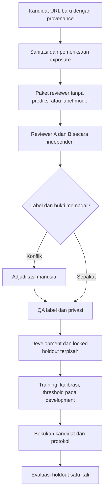

# Rencana Gold Set Indonesia dan Validasi URL/QR

> **Tanggal:** 1 November 2026.  
> **Versi protokol:** `indonesia-gold-v1`.  
> **Status awal:** Protokol dan alat persiapan; belum ada gold set berlabel manusia atau hasil evaluasi Indonesia.  
> **Model:** Satu keluarga Logistic Regression. Notebook model tetap [guardian_lab_url_qr.ipynb](../guardian_lab_url_qr.ipynb).

## 1. Tujuan dan posisi dalam Guardian Lab

Menentukan apakah classifier URL dapat dipercaya untuk kasus phishing Indonesia sebelum dihubungkan ke aplikasi. Ini mendukung pilar **Recognize**. URL hasil dekode QR memakai classifier yang sama. Sandbox tetap menangani proteksi ketika membuka tautan, dan Act tetap berupa Guardian Share Card.

Sasaran tahap ini adalah kualitas label dan bukti evaluasi. Gold set bukan nama baru untuk dataset yang sudah diaudit otomatis. Model, heuristik, maupun jawaban LLM tidak membuat ground truth.

Rujukan: [rencana ML](./machine-learning-plan.md), [riset sumber](./url-qr-dataset-research.md), [aturan repo](../AGENTS.md), dan hasil aktual dalam notebook model.

## 2. Titik awal yang harus dipertahankan

| Fakta v3                                                      | Implikasi                                                             |
| ------------------------------------------------------------- | --------------------------------------------------------------------- |
| Fit 432.793 URL dari empat sumber                             | Semua URL/domain yang sudah dipakai harus masuk pemeriksaan exposure. |
| Mean deskriptif lima evaluasi 73,75% menjadi 84,37%           | Ini bukan estimasi accuracy trafik Indonesia.                         |
| Phresh domain baru 80,48% menjadi 73,85%                      | Perbaikan tidak seragam; penurunan wajib tetap dilaporkan.            |
| Challenge URL-Phish 97,09%, recall sekitar 64,01%             | Accuracy tidak berarti seluruh phishing tertangkap.                   |
| Challenge didominasi benign dan jumlah katalog/berkas berbeda | Challenge tidak menggantikan gold set lokal yang ditinjau.            |

V1, v2, v3, artifact, serta hasilnya dipertahankan. Tidak mengubah bobot atau threshold dari hasil final test berikutnya.

## 3. Urutan pekerjaan dan batas otomatisasi

| Tahap | Pekerjaan                                               | Bukti selesai                                                 | Pelaksana                                          |
| ----- | ------------------------------------------------------- | ------------------------------------------------------------- | -------------------------------------------------- |
| P0    | Bekukan protokol, schema, dan aturan exposure           | Dokumen ini dan template kosong                               | Otomatis                                           |
| P1    | Siapkan registry exposure, kandidat, dan paket reviewer | Manifest hash, audit input, paket tanpa skor model            | Otomatis; kandidat baru memerlukan sumber yang sah |
| P2    | Anotasi independen, adjudikasi, dan QA                  | Label serta referensi bukti dari manusia                      | Dua reviewer; adjudikator untuk konflik            |
| P3    | Pisahkan development dan final holdout                  | Manifest kelompok/waktu, custodian, dan pemeriksaan kebocoran | Otomatis dengan keputusan kurasi manusia           |
| P4    | Audit kesalahan development, perbaiki model, kalibrasi  | Protokol eksperimen dan satu kandidat terpilih dari validasi  | Notebook model                                     |
| P5    | Bekukan model dan evaluasi final satu kali              | Metrik, interval, coverage, model card                        | Evaluator sesuai protokol                          |
| P6    | Integrasi URL/QR setelah gate terpenuhi                 | Tes API nyata, privacy, provenance QR, dan UI                 | Tahap aplikasi berikutnya                          |

Pembuatan template tidak menyelesaikan P2. Tanpa label manusia, status harus `pending_human_review`; tidak mengeluarkan accuracy nol, accuracy perkiraan, atau gold set sintetis.



## 4. Definisi label dan bukti

| Label anotasi  | Makna                                                                                                | Pemakaian                                                          |
| -------------- | ---------------------------------------------------------------------------------------------------- | ------------------------------------------------------------------ |
| `phishing`     | Bukti menunjukkan URL menyamar atau menipu untuk memperoleh kredensial/data sensitif tanpa otorisasi | Label proyek `1` setelah QA                                        |
| `benign`       | Bukti mendukung bahwa URL spesifik tidak melakukan phishing pada waktu observasi                     | Label proyek `0`; tidak menjamin bebas malware atau aman selamanya |
| `uncertain`    | Bukti tidak cukup, bertentangan, kedaluwarsa, atau redaksi menghilangkan konteks penting             | Antrean tinjau; tidak otomatis benign                              |
| `out_of_scope` | Non-URL, QRIS merchant, spam/malware/APK tanpa bukti phishing, atau tugas di luar classifier         | Coverage dan batas cakupan; tidak dipaksa menjadi kelas phishing   |

Dasar label harus berupa referensi kasus yang dapat ditinjau, waktu observasi, serta alasan. Label dari feed menjadi petunjuk, bukan pengganti pemeriksaan gold. Domain resmi dapat disusupi; HTTPS, popularitas, dan `.id` tidak menetapkan label benign.

Bukti publik atau arsip yang sudah disanitasi diprioritaskan. Agent tidak membuka target, mengunduh HTML target, atau menjalankan halaman. Jika manusia perlu meninjau halaman, gunakan lingkungan analisis terisolasi yang sudah diverifikasi; antarmuka sandbox simulasi tidak menjadi bukti isolasi. Tidak perlu memasukkan kredensial untuk memeriksa sebuah halaman.

## 5. Cakupan Indonesia dan pengumpulan kandidat

Keterkaitan Indonesia harus memiliki alasan yang dapat ditinjau: target brand/instansi Indonesia, konteks bahasa/pengguna Indonesia, atau referensi laporan lokal. Akhiran `.id` saja belum cukup. PhishVN tidak berubah menjadi dataset Indonesia karena dekat secara regional.

| Cakupan                         | Kandidat phishing                         | Pembanding benign yang sulit                   |
| ------------------------------- | ----------------------------------------- | ---------------------------------------------- |
| Bank/e-wallet                   | Penyamaran login, verifikasi, aktivasi    | Login dan bantuan resmi                        |
| Kurir/perdagangan               | Resi atau pembayaran palsu                | Tracking dan transaksi resmi                   |
| Undangan/hadiah/bantuan         | Permintaan data melalui tautan tiruan     | Undangan, promosi, dan bantuan resmi           |
| Pemerintah                      | Penyamaran layanan publik                 | Portal dan formulir resmi                      |
| Hosting bersama/domain disusupi | Tenant baru atau path yang disalahgunakan | Tenant sah dan path kompleks pada domain resmi |
| Shortlink/QR                    | URL tujuan tidak jelas atau URL dari QR   | Shortlink resmi dan QR yang menuju URL sah     |

Setiap sumber mencatat hak penggunaan dan provenance. Tidak mengirim permintaan akun, pesan, atau data kepada penyedia atas nama pengguna tanpa instruksi. Kandidat baru tidak harus berasal dari trafik pengguna; riwayat pribadi tidak otomatis menjadi bahan anotasi.

Mulai dengan **pilot proses anotasi 1.000–2.000 kandidat** jika tersedia. Ini sasaran proses yang diusulkan, bukan dataset yang sudah dikumpulkan atau ukuran yang membuktikan FPR rendah. Pilot yang dilihat developer diperlakukan sebagai development; final holdout memerlukan pengumpulan dan pemisahan tersendiri.

## 6. Privasi, redaksi, dan representasi

1. Jangan meminta atau menyimpan PIN, OTP, password, token sesi, rekening, NIK, email korban, atau identitas korban.
2. Kandidat harus disanitasi sebelum diekspor. Parser/sanitizer berversi harus sama dengan model; paket reviewer memakai target defanged dan tidak mencetak URL aktif.
3. Ringkasan bukti harus sudah ditinjau privasinya. Screening regex tidak membuktikan semua PII sudah hilang.
4. Source URL, evidence reference, dan catatan tidak boleh menyimpan kredensial terselubung. Gunakan alias seperti `EVID-0001` dan identitas reviewer anonim.
5. Reviewer tidak melihat label lama, skor/risk level model, atau prediksi A/B lain sebelum menyelesaikan labelnya.
6. Data, bukti privat, paket reviewer, registry exposure, dan label lokal masuk `ml/data/indonesia-gold/` yang diabaikan Git. Template ber-header kosong boleh dilacak Git.

Query/fragment tetap dikeluarkan dari fitur fondasi. Kebenaran kasus dapat memerlukan konteks yang hilang pada URL core. Dua target berbeda dapat memiliki representasi model yang sama. Catat `representation_collision` atau `query_only_discriminator`; jangan menghapus kasus sulit setelah mengetahui prediksi. Jika bukti label ikut hilang saat redaksi, tandai `uncertain` sampai tersedia bukti yang aman.

## 7. Registry exposure dan definisi holdout

Pembaruan v5/v6: setelah manifest data/model/evaluasi cocok, registry juga mengindeks test v5, development v6, holdout vendor v6, dan snapshot positif PhishTank v6. Snapshot database sebelumnya dipertahankan agar checksum exposure pada audit lama tetap dapat diperiksa. Run yang belum lengkap atau file Parquet di luar manifest tetap ditandai belum terdaftar. Sampel audit manusia PhishVN bukan gold set Indonesia, dan tidak mengisi template reviewer Indonesia secara otomatis.

Registry menyimpan hash URL canonical dan hash registered-domain/private tenant dari data tersanitasi yang diketahui, beserta checksum berkas sumber dan versi PSL. URL/domain tidak perlu dicetak atau dimasukkan ke Git untuk pencocokan ini.

Berkas inti yang diketahui mencakup cache curated dasar, development v3, serta challenge URL-Phish v3. Dataset development v3 juga mencakup seluruh subset Mendeley/PhishVN yang sebelumnya diprediksi. Staging tersanitasi boleh ditambahkan secara konservatif untuk audit-only exposure. Registry harus diperbarui ketika ada run atau sumber baru.

- Cocok hash/domain dengan registry: kandidat tidak layak diklaim sebagai final holdout baru; dapat masuk audit development yang ditandai pernah teramati.
- Tidak cocok: lolos pemeriksaan exposure yang diketahui, bukan bukti bebas overlap kampanye di seluruh internet.
- Registry hilang/tidak lengkap: status `independence_unverified`; jangan mengklaim holdout independen.
- Kampanye yang diketahui dihubungkan lintas domain. Brand yang sama saja tidak cukup untuk menyatakan kampanye sama. Kampanye yang belum diketahui tetap dilaporkan sebagai batas audit.

`url_hash` memakai URL core canonical. `model_input_hash` adalah hash representasi scheme-free sebagai proxy collision; ia bukan fingerprint seluruh feature vector. Pencocokan domain/tenant tetap wajib.

## 8. Schema dan template anotasi

Template kosong berada di [ml/templates/](../ml/templates/). Kolom tidak boleh diisi dengan prediksi model sebagai label manusia.

| Template                                                | Kolom                                                                                                                                                 |
| ------------------------------------------------------- | ----------------------------------------------------------------------------------------------------------------------------------------------------- |
| `indonesia-candidates.csv`                              | `sample_id,url_redacted,observed_at,source_id,source_version,source_license,evidence_ref,scenario,id_relevance_basis,requested_role,privacy_reviewed` |
| `indonesia-reviewer-a.csv` / `indonesia-reviewer-b.csv` | `sample_id,reviewer_id,label,confidence,reason_code,evidence_ref,human_review_confirmed,reviewed_at`                                                  |
| `indonesia-adjudication.csv`                            | `sample_id,adjudicator_id,final_label,decision_type,reason_code,evidence_ref,privacy_checked,evidence_checked,human_review_confirmed,adjudicated_at`  |
| `indonesia-error-review.csv`                            | `sample_id,model_version,partition,error_kind,reason_code,evidence_ref,reviewer_id,human_review_confirmed`                                            |

Aturan nilai:

- `sample_id`: alias stabil `GLI-...`; bukan nama, nomor HP, email, atau kredensial.
- `requested_role`: `development_pilot` atau `locked_test_candidate`. Nama ini hanya permintaan peran, bukan sertifikasi independensi.
- `observed_at` / `reviewed_at`: ISO 8601 dengan timezone; waktu unduh/ingestion tidak dianggap first-seen.
- `confidence`: `high`, `medium`, atau `low`; skor confidence reviewer tidak menjadi probabilitas ML.
- `scenario`: `bank_wallet`, `courier_commerce`, `invitation_prize_aid`, `government`, `shared_hosting`, `shortlink_qr`, atau `other`.
- `decision_type` untuk adjudikasi: `resolve_disagreement`, `resolve_uncertainty`, atau `evidence_correction`.
- `privacy_reviewed`, `human_review_confirmed`, `privacy_checked`, `evidence_checked`: `yes`/`no`. Nilai `yes` memerlukan tindakan manusia; agent tidak boleh mengisinya seolah-olah telah terjadi.
- `source_license=unknown` atau evidence kosong: pending kelayakan, bukan gold siap evaluasi.
- Semua label review memakai empat nilai pada bagian 4; mapping ke 0/1 hanya untuk label binary yang lolos QA.

Alasan keterkaitan Indonesia harus berupa bukti konteks yang dijelaskan, bukan keputusan otomatis dari TLD. Detail skenario tidak boleh mengungkap label yang diharapkan dalam paket reviewer.

Paket reviewer menambahkan `target_defanged` dan `observed_at` sebagai konteks. Tim boleh mengisi paket lalu menyalinnya ke file input reviewer; notebook hanya mengimpor kolom anotasi sesuai schema dan tidak memakai kolom konteks sebagai label. File input yang sudah diisi tidak ditimpa saat rerun. Paket keluaran dapat dibuat ulang; simpan hasil kerja di file input sebelum rerun.

## 9. Dua reviewer, kesepakatan, dan adjudikasi

1. Koordinator membuat paket A/B dari kandidat yang lolos screening, tanpa skor model, label sumber, atau jawaban reviewer lain.
2. Dua manusia berbeda mengisi label, confidence, reason code, referensi bukti, dan waktu secara independen.
3. Laporan agreement menampilkan jumlah pasangan, raw agreement, Cohen's kappa empat label, dukungan tiap label, serta confusion table. Kappa tidak tersedia jika dukungan membuatnya tidak terdefinisi; jangan menggantinya dengan angka sempurna.
4. Kesepakatan binary menjadi usulan `provisionally_reviewed`, bukan otomatis locked gold. Confidence rendah dan bukti lemah tetap ditinjau.
5. Konflik, label uncertain, dan perubahan keputusan memerlukan adjudikator yang berbeda dari dua reviewer. Adjudikasi mencatat bukti, alasan, dan keputusan; tidak sekadar voting.
6. Koordinator menyelesaikan QA batch, audit privasi, kelayakan sumber, serta alasan pengeluaran sebelum finalisasi.

Sistem dapat memeriksa bahwa ID reviewer berbeda dan kolom terisi, tetapi tidak membuktikan bahwa dua manusia benar-benar bekerja independen. Tanggung jawab proses tetap pada tim. Tidak memakai dua respons LLM sebagai pengganti dua reviewer.

## 10. Development, locked test, dan ukuran sampel

| Peran             | Penggunaan yang diperbolehkan                                                               |
| ----------------- | ------------------------------------------------------------------------------------------- |
| Pilot teramati    | Menguji rubric, menyempurnakan proses, dan mengaudit data; diperlakukan sebagai development |
| Local development | Fit/tune/calibration/threshold pada partisi kelompok/waktu terpisah                         |
| Locked final test | Dibuka untuk evaluasi setelah satu kandidat, threshold, dan protokol dibekukan              |

Custodian menyimpan label locked test terpisah dari proses tuning. `.gitignore` bukan kontrol akses atau pembutaan reviewer. Jika developer melihat label/prediksi test untuk mengubah desain, dataset tersebut menjadi teramati dan diperlukan holdout baru untuk klaim final berikutnya.

Komponen kelompok menghubungkan registered-domain/private tenant serta campaign ID yang diketahui. Kelompok tidak melintasi partisi. Batas tanggal ditetapkan sebelum tuning; kelompok yang melintasi batas dipurge atau dialokasikan dengan aturan yang dilaporkan. Data tanpa waktu observasi tidak dijadikan bukti generalisasi temporal.

Ukuran final ditetapkan dari target FPR, jumlah benign/kelompok independen, dan interval ketidakpastian. Sebagai perkiraan perencanaan dengan asumsi observasi independen, nol false positive dari sekitar 3.000 benign memberi batas atas satu sisi 95% sekitar 0,1%; itu bukan jaminan pada data yang berkelompok. Pilot kecil tidak membuktikan FPR 0,1%, dan bootstrap bernilai nol dari nol kejadian tidak cukup untuk menyatakan risiko nol.

Test case-control seimbang berguna untuk recall/FPR, tetapi precision dan kalibrasi trafik tidak boleh disimpulkan dari prevalensi buatan. Catat desain sampling; jangan menggunakan test yang diseimbangkan untuk mengklaim probabilitas trafik pengguna.

## 11. Audit kesalahan dan perbaikan yang diizinkan

Audit development dilakukan sebelum membuka final test. Template error review memisahkan `false_positive`, `false_negative`, `unsupported`, dan `uncertain_label`.

| Reason code                                                  | Hal yang perlu diperiksa                                 |
| ------------------------------------------------------------ | -------------------------------------------------------- |
| `label_disagreement` / `stale_status`                        | Kebenaran label, waktu observasi, dan bukti              |
| `official_login_hard_negative` / `benign_promo_tracking`     | Negatif sah yang menyerupai phishing                     |
| `compromised_legit_domain`                                   | Keterbatasan identitas domain sebagai sinyal             |
| `shortlink_destination_unknown` / `query_only_discriminator` | Informasi pembeda di luar URL core                       |
| `redaction_removes_evidence` / `representation_collision`    | Kehilangan konteks atau target berbeda dengan fitur sama |
| `out_of_distribution_language_hosting`                       | Generalisasi bahasa, hosting, dan konteks lokal          |
| `model_confidence_calibration`                               | Ketepatan probabilitas dan kebijakan keputusan           |
| `unsupported_input` / `insufficient_evidence`                | Coverage dan kasus yang belum bisa dinilai               |

Alasan adalah hasil tinjauan, bukan diagnosis otomatis dari keyword. Perbaikan yang diperbolehkan: tambah data development yang terverifikasi, perbaiki preprocessing konsisten, uji fitur yang tersedia saat inferensi, lalu tuning Logistic Regression dengan budget tercatat. Tidak mengubah label, menghapus kesalahan, menambah allowlist SAFE, atau menurunkan threshold dari hasil final test.

## 12. Kriteria kelulusan yang diusulkan

Ini target eksperimen awal, bukan hasil atau janji yang telah dicapai. Bekukan target dan metode interval sebelum fitting kandidat untuk evaluasi final. Perubahan target setelah melihat final test memerlukan protokol/holdout baru.

| Gate            | Syarat                                                                                                                                                     |
| --------------- | ---------------------------------------------------------------------------------------------------------------------------------------------------------- |
| Data            | Provenance/hak penggunaan jelas, QA privasi selesai, dua reviewer dan adjudikasi yang diperlukan lengkap                                                   |
| Independensi    | Tidak ada overlap URL/domain yang diketahui; kelompok kampanye yang diketahui terpisah; batas audit dicatat                                                |
| Warning         | Usulan: recall phishing minimal 85% dengan FPR maksimal 1%; laporkan interval, dukungan kelas/domain, dan hasil per segmen                                 |
| Bukti statistik | Klaim memenuhi target hanya jika metode interval yang ditetapkan dan dukungan sampel mendukungnya; interval yang melintasi target berarti belum meyakinkan |
| HIGH            | FPR target 0,1% hanya bila dukungan benign dan ketidakpastian memadai; dapat berstatus belum didukung                                                      |
| Robustness      | Penurunan pada sumber/segmen penting dilaporkan dan ditinjau; rata-rata tidak menutupi kegagalan segmen                                                    |
| Probability     | Kalibrasi pada calibration partition; reference distribution dicatat; tidak disebut probability trafik tanpa bukti                                         |
| Reproduksi      | Data/model/threshold/schema/checksum/version pin, parity URL/QR, dan save/reload teruji                                                                    |

Metrics wajib: confusion matrix, accuracy, balanced accuracy, precision, recall, FPR, F1, AP/PR curve, Brier/log loss, coverage input, serta interval yang sesuai. Laporkan interval binomial/Wilson dengan asumsi row-IID dan bootstrap per domain secara terpisah; keduanya tidak membuktikan independensi kampanye atau label sempurna.

Kandidat dan baseline dibekukan sebelum final evaluation. Gunakan evaluasi berpasangan pada sampel yang sama. Jika gate gagal, jangan promosikan model atau memilih threshold baru dari final test. Catat kegagalan dan siapkan siklus development/holdout berikutnya.

## 13. Struktur berkas dan kontrak alat persiapan

**Klarifikasi alur 1 November 2026:** gold set Indonesia bukan syarat untuk seluruh eksperimen development. [Training ulang v4](./retraining-v4-plan.md) boleh memakai data development yang telah tersedia pada run terpisah dan mempertahankan v3 sebagai baseline. Eksperimen itu tidak menyelesaikan P2–P5 validasi Indonesia, tidak membuat label manusia, dan tidak mengklaim benchmark lama sebagai holdout baru.

```text
ai-agent-docs/indonesia-gold-set-plan.md     Protokol dan aturan kerja
guardian_lab_gold_set_indonesia.ipynb       Persiapan, registry, template, audit anotasi
guardian_lab_url_qr.ipynb                   Notebook satu keluarga classifier
ml/templates/indonesia-*.csv                Header kosong; boleh dilacak Git
ml/data/indonesia-gold/                     Kandidat/review/hasil lokal; diabaikan Git
  input/                                   CSV yang diisi tim
  registry/                                Hash exposure dan manifest
  reviewer-packs/                          Paket terpisah A/B tanpa skor model
  reports/                                 Audit agregat dan status pending
  reviewed/                                Usulan label, belum locked final gold
```

Notebook persiapan tidak melatih classifier, membuka target, menghubungi LLM, atau mengisi label manusia. Input kosong menghasilkan status pending dan template; tidak menghasilkan dataset final atau nilai evaluasi. Data lama tidak otomatis diubah menjadi gold set Indonesia.

Notebook model v3 yang sudah dibekukan tidak diubah untuk training baru pada tahap ini. Integrasi data lokal dilakukan sebagai run versi baru setelah label dan pembagian data memenuhi protokol. Persiapan layanan riset internal shadow, adapter dan Mode Manusia/Geek dapat diuji sebelum gate produksi terpenuhi, sebagaimana [rencana keandalan](./model-hardening-plan.md). Aktivasi publik/deployment produksi tetap memerlukan bukti validasi yang memadai.

## 14. Checklist dan catatan keputusan

- [x] Protokol, schema, dan template tersinkronisasi.
- [x] Registry exposure v1–v8 dibangun dari berkas yang tersedia; cakupan dan kekurangannya dilaporkan.
- [ ] Kandidat baru dengan provenance dan bukti Indonesia tersedia.
- [ ] Dua reviewer manusia menyelesaikan label secara independen.
- [ ] Konflik diadjudikasi dan QA privasi/bukti selesai.
- [ ] Development dan locked holdout dipisahkan sebelum tuning.
- [ ] Ukuran sampel, threshold policy, dan kriteria interval dibekukan.
- [ ] Audit kesalahan development selesai; satu kandidat dipilih dari validasi.
- [ ] Model, kalibrator, dan threshold dibekukan sebelum membuka holdout.
- [ ] Evaluasi lengkap dan keterbatasan diterbitkan, termasuk target yang tidak tercapai.
- [ ] Integrasi aplikasi baru dimulai setelah gate yang diperlukan terpenuhi.

Perubahan protokol mencatat tanggal, alasan, fase, exposure data, dan kebutuhan holdout baru. Metadata-only repair tidak boleh mengubah estimator, transformasi, kalibrator, atau threshold secara diam-diam; hash payload sebelum/sesudah serta lineage harus dapat diperiksa.

### Catatan eksekusi persiapan — 1 November 2026

- Notebook persiapan dijalankan penuh: 15 cell, 8 cell kode, tanpa error. Dua belas kasus regresi anotasi sintetis diuji hanya dalam memori, tanpa menulis fixture sebagai kandidat atau review manusia.
- Registry dibangun dari empat cache tersanitasi: curated dasar, development v3, challenge URL-Phish v3, dan staging audit. Total 2.428.449 baris yang saling overlap menghasilkan **917.115 hash URL unik** dan **515.650 hash domain/tenant unik**. Ini hitungan exposure, bukan jumlah gold set atau data training baru.
- Checksum sumber, parser, snapshot PSL offline, serta database tersimpan dalam `ml/data/indonesia-gold/registry/manifest.json`. Sumber wajib tersedia dan tidak ditemukan folder run lain yang belum terdaftar. Audit dibatasi berkas lokal yang tercatat; overlap kampanye global dan baris yang tidak dipersistensikan belum dapat dibuktikan.
- Kelima template input masih kosong: **0 kandidat, 0 pasangan review valid, 0 usulan label binary**. Status `pending_human_review`; evaluasi classifier dan acceptance gate belum dijalankan.
- Notebook model, artifact model v3, dan metadata pembekuannya tidak berubah. Pekerjaan berikutnya adalah menyediakan kandidat baru beserta bukti Indonesia dan hak penggunaan, lalu dua review manusia serta QA sesuai protokol ini.

Pembaruan setelah v5/v6: registry exposure kini mencatat **1.141.417 hash URL unik** dan **730.794 hash domain/tenant unik** dari sembilan cache tersanitasi. Run v4 yang memakai sumber lama diverifikasi, dan manifest data baru v5/v6 cocok dengan pembekuan serta evaluasinya. Snapshot registry sebelumnya disimpan dengan checksum asal. Ini audit exposure, bukan jumlah label Indonesia; input gold set Indonesia masih kosong dan status tetap `pending_human_review`.

Ringkasan yang aman dibagikan tersedia pada [laporan agregat persiapan](../ml/reports/indonesia-gold-preparation.json). Kandidat, label, dan database registry tetap lokal; laporan agregat tidak memuat URL target atau identitas pribadi.

Pembaruan setelah v7: registry kini mencatat **1.148.933 hash URL unik** dan **737.796 hash domain/tenant unik** dari sebelas cache. Tambahan fit v7 yang dikarantina dan test Phish360 hanya didaftarkan sesudah checksum model, source runtime, kode notebook, data, protokol dan evaluasi cocok. Snapshot v1-v6 sebelum intake tetap tersedia untuk mengaudit kebaruan test v7. Notebook persiapan dijalankan ulang penuh, delapan sel kode tanpa error, dan tidak ada run yang belum terdaftar. Input anotasi Indonesia tetap kosong; dataset Vietnam/Phish360 dan 73 kandidat pilot terpisah tidak diubah menjadi gold Indonesia.

Referensi metode: [preprocessing/leakage scikit-learn 1.8](https://scikit-learn.org/1.8/common_pitfalls.html), [threshold keputusan](https://scikit-learn.org/1.8/modules/classification_threshold.html), dan [kalibrasi probabilitas](https://scikit-learn.org/1.8/modules/calibration.html). Keputusan sampling dan gate di atas adalah rancangan proyek, bukan klaim bahwa model saat ini telah memenuhinya.

Pembaruan v8: registry kini memuat **14 cache, 1.154.397 hash URL unik dan 742.979 hash domain/tenant unik**, tanpa run belum terdaftar. Development gabungan, holdout TR-OP dan seluruh intake tersanitasi valid dicatat setelah model, kode, data dan evaluasi diverifikasi, termasuk ledger perbaikan metadata tampilan. Snapshot sebelum intake v8 tetap tersedia. Notebook persiapan dijalankan penuh tanpa error; input anotasi Indonesia tetap kosong dan tidak ada label manusia baru yang dibuat agent.

Pembaruan persiapan v10: 17 cache kini mencakup **1.158.886 hash URL dan 747.365 hash domain/tenant**, tanpa run belum terdaftar. V9 diverifikasi hanya memakai data lama; v10 ditambahkan sebagai intake publik terverifikasi sebelum fitting, bukan training selesai. Sebanyak 4.489 core baru tercakup termasuk reserve/cap, sedangkan error cases development hanya mengulang exposure lama. Snapshot registry sebelumnya dipertahankan. Input anotasi tetap kosong; IOB hard-negative historis dan PhishTank positif terbaru tidak menjadi gold Indonesia atau temporal holdout dua kelas.
