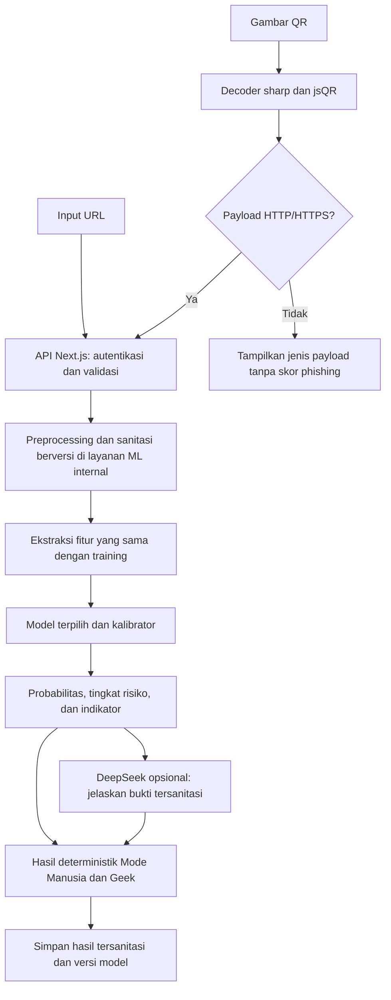

# Rencana Machine Learning URL & QR — Guardian Lab

> **Status:** Pengguna memilih v6 sebagai model utama sementara; notebook utama `guardian_lab_url_qr_data_v6.ipynb` dan API shadow memakai artifact v6 asli. Eksperimen v1-v9 serta persiapan v10 dipertahankan sebagai arsip riset. Validasi Indonesia dan aktivasi produksi belum selesai.  
> **Tanggal:** 1 November 2026.  
> **Cakupan yang disepakati:** Deteksi phishing URL dan URL hasil dekode QR terlebih dahulu.  
> **Keputusan model:** Gunakan satu model utama dahulu, frozen Logistic Regression v6, sebagaimana [catatan pemilihan](./selected-model-v6.md). Threshold asli dan hasil validasi tetap dipertahankan; pemilihan ini tidak mengaktifkan produksi.

Referensi kode aplikasi web pada dokumen ini menunjuk repositori guardian_lab pada commit yang diperiksa. Implementasi ML dikerjakan di guardian_lab_ai. Dokumen ini menjadi acuan pengerjaan ML tahap pertama, dari pengumpulan data hingga integrasi. Ketentuan umum tetap mengikuti [AGENTS.md](../AGENTS.md), [alur kerja agent](https://github.com/DeryWahyu/guardian_lab/blob/4a4aaa6b808d5d7ef5ab30a77b010843aaf47c1b/ai-agent-docs/agent-workflow.md), dan [kualitas kode](https://github.com/DeryWahyu/guardian_lab/blob/4a4aaa6b808d5d7ef5ab30a77b010843aaf47c1b/ai-agent-docs/code-quality.md). Rencana di sini melengkapi [arsitektur sistem](https://github.com/DeryWahyu/guardian_lab/blob/4a4aaa6b808d5d7ef5ab30a77b010843aaf47c1b/ai-agent-docs/system-architecture.md); fitur di luar tahap ini tetap menjadi backlog.

## 1. Tujuan dan batas kemampuan

[Tahap v10](./recall-cnn-v10-plan.md) mengikuti audit development, data berbukti, persiapan CNN karakter tanpa SVD dan gate holdout sebelum fitting. [Hasil persiapan](./recall-cnn-v10-results.md) mencatat 84.545 URL audit, FPR hosting bersama v8 5,82%, dan 4.472 tambahan publik yang belum dilatih. CNN belum dilatih karena reserve hanya 913 benign historis serta dua phishing terbaru, tanpa holdout temporal dua kelas memadai. Notebook v10 tidak membuat accuracy CNN; runtime v6 dan gate Indonesia tetap dipertahankan.

[Perbandingan keluarga model v9](./model-family-comparison-v9-plan.md) telah dilatih dalam [notebook](../guardian_lab_url_qr_comparison_v9.ipynb). Dua konfigurasi CatBoost dan dua LR memakai 535.504 fitting identik. [Hasil](./model-family-comparison-v9-results.md) menunjukkan CatBoost lebih baik daripada LR dengan 102 fitur ringkas yang sama, tetapi lebih rendah daripada LR lengkap v8 pada seluruh tujuh benchmark teramati. Semua kandidat gagal guard development; runtime tetap v6. Kompresi SVD membatasi kesimpulan tentang seluruh keluarga model. Threshold kontrol v6 pada perbandingan berbeda dari kebijakan runtime asli yang tetap dipertahankan.

[Perluasan v8](./data-expansion-v8-plan.md) telah menambah 2.753 URL fitting dari TR-OP sehingga fit menjadi 535.504 URL, dengan vocabulary/scaler baru. Tiga kandidat Logistic Regression konvergen; guard per sumber menolak semuanya dan keputusan mempertahankan v6 tetap berlaku. [Hasil v8](./data-expansion-v8-results.md) mencatat perbaikan pada holdout domain baru dan Phish360, regresi lain, label manual yang dilaporkan penerbit, keterbatasan sumber yang sama pada development/test, serta metadata-only repair tampilan tanpa perubahan numerik. Holdout TR-OP kini teramati dan registry exposure diperluas sampai v8.

Iterasi struktur [v7](./structural-retraining-v7-plan.md) telah dijalankan penuh dalam [notebook](../guardian_lab_url_qr_structural_v7.ipynb). Empat konfigurasi dilatih pada 532.751 URL setelah karantina fit-only; hasilnya mencakup test tambahan 7.516 URL Phish360 dengan klaim kurasi manual penulis dan domain di luar exposure lama. [Hasil lengkap](./structural-retraining-v7-results.md) menunjukkan recall PhishTank meningkat dan FPR vendor menurun, tetapi recall pada sumber baru dan audit manusia kecil menurun. Tidak ada promosi model atau aktivasi produksi; Phish360 menjadi benchmark teramati setelah evaluasi ini.

Tahap audit sebelumnya mengikuti [rencana dan hasil audit](./model-hardening-plan.md) serta [kontrak API shadow](./shadow-api-contract.md). Sesuai pilihan pengguna, bukti manusia memakai audit PhishVN terpublikasi terlebih dahulu. [Notebook audit](../guardian_lab_model_hardening.ipynb) memeriksa 84.000 tune URL dan mencocokkan 200 kasus publik; 73 kandidat Indonesia belum berlabel. API internal menggunakan artifact v6 asli dan metrik monitoring agregat tanpa target. Tahap audit tersebut tidak melakukan training ulang, koreksi label otomatis atau aktivasi frontend; training baru sesudahnya dilakukan terpisah pada v7.

Eksperimen [v5](./recall-improvement-v5-plan.md) dan [v6](./data-improvement-v6-plan.md) telah dijalankan dengan data uji baru yang dipisahkan sebelum fitting. V5 tidak membaik. V6 memperluas fit menjadi 532.793 URL dan memperbaiki recall pada operasi false alarm rendah terhadap baseline dengan threshold kontrol development yang sama anggarannya. Recall mentah terhadap kebijakan asli v3 dan audit manusia kecil menurun; baseline tetap dipertahankan dan tidak ada promosi produksi. Pisahkan laporan vendor binary, feed komunitas positif saja, serta benchmark teramati; jangan menyajikan kontrol tambahan sebagai preregistrasi awal atau metrik trafik Indonesia.

Eksperimen pembobotan yang sudah dikerjakan mengikuti [protokol training ulang v4](./retraining-v4-plan.md). Data development lama dipakai untuk menguji pembobotan Logistic Regression sambil mempertahankan v3 sebagai baseline beku. Hasilnya tidak disebut evaluasi independen Indonesia.

V4 telah selesai: enam konfigurasi dilatih ulang, semuanya konvergen, dan konfigurasi v3 tetap menang berdasarkan tune. Keputusan klasifikasi serta accuracy benchmark teramati tidak meningkat; baseline dipertahankan. Bukti tersedia di [notebook v4](../guardian_lab_url_qr_retraining_v4.ipynb) dan [laporan agregat v4](../ml/reports/retraining-v4.json). Tidak mengklaim versi artifact baru sebagai peningkatan model.

Pekerjaan berikutnya mengikuti [protokol gold set Indonesia](./indonesia-gold-set-plan.md). Protokol menetapkan schema, blinding reviewer, pemeriksaan exposure v1–v3, adjudikasi, pemisahan holdout, audit kesalahan, dan gate sebelum integrasi. Persiapan data dilakukan di notebook pendamping; model v3 yang dibekukan dipertahankan sampai label manusia serta validasi lokal memadai.

Arsip v3 tersedia pada [notebook utama](../guardian_lab_url_qr.ipynb): fit 432.793 URL dari empat sumber; source-aware tuning dan threshold; challenge baru 85.824 URL. Rata-rata deskriptif accuracy lima evaluasi berubah dari 73,75% ke 84,37%, tetapi Phresh domain baru turun 80,48% ke 73,85%. Tidak ada klaim peningkatan seragam atau accuracy produksi. PhiUSIIL/Mendeley/PhishVN yang dipakai dalam pengembangan v3 tidak lagi disebut test independen. Challenge URL-Phish memiliki bias institusi serta selisih katalog/berkas, sehingga tetap bukan gold set Indonesia.

Hasil aktual v1 tersedia pada [model card](../ml/reports/model-card.md), [audit data](../ml/reports/data-audit.json), dan [test final](../ml/reports/final-test.json). Pada 80.052 sampel test domain baru, peringatan MEDIUM+HIGH memperoleh recall 69,86% dan FPR 0,9744%; HIGH memperoleh recall 31,51% dan FPR 0,0618%. Precision benchmark tidak boleh disebut accuracy. Recall, gold set Indonesia, data 2026, dan audit kampanye masih menjadi batas sebelum penggunaan produksi.

Membangun classifier yang mempelajari pola URL untuk memberikan indikator kemungkinan phishing, disertai alasan yang dapat ditelusuri. Target pelatihan adalah klasifikasi biner: `benign = 0` dan `phishing = 1`. Label benign berarti tidak terindikasi phishing dalam cakupan data, bukan jaminan bebas malware atau aman untuk memasukkan kredensial.

| Termasuk tahap pertama                                      | Ditunda ke tahap berikutnya                                        |
| ----------------------------------------------------------- | ------------------------------------------------------------------ |
| Input URL HTTP/HTTPS dan dekode gambar QR menjadi URL       | Classifier malware APK dan analisis dinamis aplikasi               |
| Fitur leksikal URL, pola karakter, dan kemiripan brand      | Screenshot halaman, logo, HTML/DOM, dan model visual               |
| Dataset, training, evaluasi, kalibrasi, dan artifact model  | WHOIS/RDAP, reputasi IP, pengambilan konten, dan resolusi redirect |
| Layanan inferensi internal dan integrasi API yang sudah ada | Ensemble, URLNet/CNN, dan Transformer sebelum baseline terbukti    |
| Hasil Mode Manusia/Geek dan metadata versi analisis         | Menyatakan URL berekstensi `.apk` pasti malware                    |

QR adalah format masukan, bukan kelas ancaman atau model terpisah. QR non-URL, termasuk teks, Wi-Fi, dan payload pembayaran QRIS, tidak dipaksa menjadi URL atau diberi skor phishing. Tahap ini tidak memvalidasi keaslian merchant QRIS. Tautan pendek dan domain sah yang disusupi tetap menjadi keterbatasan jika tujuannya tidak tampak pada teks URL.

## 2. Kondisi kode sebelum implementasi

| Lokasi                                                                                                                                                  | Kondisi yang perlu diperhatikan                                                                                                       |
| ------------------------------------------------------------------------------------------------------------------------------------------------------- | ------------------------------------------------------------------------------------------------------------------------------------- |
| [lexical.ts](https://github.com/DeryWahyu/guardian_lab/blob/4a4aaa6b808d5d7ef5ab30a77b010843aaf47c1b/lib/analysis/lexical.ts)                           | Scoring berbasis aturan; belum model yang belajar dari data. Memiliki pengembalian SAFE langsung untuk domain tertentu dan localhost. |
| [deepseek.ts](https://github.com/DeryWahyu/guardian_lab/blob/4a4aaa6b808d5d7ef5ab30a77b010843aaf47c1b/lib/analysis/deepseek.ts)                         | Sudah memiliki PII scrubber dan fallback, tetapi skor dapat diambil dari keluaran LLM.                                                |
| [qr.ts](https://github.com/DeryWahyu/guardian_lab/blob/4a4aaa6b808d5d7ef5ab30a77b010843aaf47c1b/lib/analysis/qr.ts)                                     | Memakai sharp/jsQR, tetapi terdapat respons fixture serta perlakuan gambar sangat kecil sebagai QR simulasi pada jalur produksi.      |
| [analysis-gateway.tsx](https://github.com/DeryWahyu/guardian_lab/blob/4a4aaa6b808d5d7ef5ab30a77b010843aaf47c1b/components/landing/analysis-gateway.tsx) | URL hasil QR diteruskan sebagai analisis URL; asal QR belum dipertahankan. Toggle PII belum menjalankan sanitasi input.               |
| [analyze-url](https://github.com/DeryWahyu/guardian_lab/blob/4a4aaa6b808d5d7ef5ab30a77b010843aaf47c1b/app/api/analyze-url/route.ts)                     | Mengambil pengguna tanpa mewajibkan autentikasi; validasi masih manual.                                                               |
| [forensic-logger.ts](https://github.com/DeryWahyu/guardian_lab/blob/4a4aaa6b808d5d7ef5ab30a77b010843aaf47c1b/lib/analysis/forensic-logger.ts)           | Menyimpan target yang diterima; kegagalan database dapat menghasilkan ID sementara.                                                   |
| [test-harness.ts](https://github.com/DeryWahyu/guardian_lab/blob/4a4aaa6b808d5d7ef5ab30a77b010843aaf47c1b/tests/e2e/helpers/test-harness.ts)            | Bisa mengganti eksekusi handler dengan specification oracle. Hasilnya bukan bukti keberhasilan model produksi.                        |

Temuan ini adalah pekerjaan integrasi mendatang. Pembuatan dokumen tidak mengubah perilaku aplikasi atau menyatakan kekurangan tersebut sudah diperbaiki.

## 3. Kandidat model dan aturan pemilihan

| Kandidat                              | Masukan                                                            | Kelebihan untuk proyek                                                                        | Kekurangan / perhatian                                                                                 |
| ------------------------------------- | ------------------------------------------------------------------ | --------------------------------------------------------------------------------------------- | ------------------------------------------------------------------------------------------------------ |
| Baseline heuristik                    | Fitur leksikal                                                     | Membandingkan peningkatan terhadap pendekatan sekarang; mudah ditelusuri.                     | Aturan dan bobot manual; tidak belajar dari contoh baru. Bypass SAFE tidak boleh menjadi oracle label. |
| Logistic Regression + TF-IDF karakter | URL yang sudah disanitasi; eksperimen dapat menambah fitur numerik | Relatif ringan, cocok sebagai pembanding pola karakter, dan dapat dilatih pada CPU.           | Hubungan antarfitur terbatas; ukuran vocabulary perlu dibatasi.                                        |
| **CatBoostClassifier**                | Fitur numerik serta kategori terbatas seperti TLD dan skema        | Sesuai dengan fitur URL yang direncanakan; mendukung kategori secara native dan training CPU. | Bergantung pada kualitas fitur; tetap membutuhkan tuning dan pengujian generalisasi.                   |
| XGBoostClassifier                     | Fitur sebanding dengan CatBoost melalui preprocessing yang sesuai  | Pembanding untuk hubungan nonlinear dan pengaturan regularisasi.                              | Encoder, tuning, waktu training, dan ukuran artifact harus diukur.                                     |

CatBoost adalah rekomendasi awal, bukan pemenang yang sudah ditentukan. Semua kandidat memakai snapshot data, pembagian data, label, dan anggaran eksperimen yang tercatat. Perbedaan representasi fitur dilaporkan. Tidak ada klaim akurasi sebelum benchmark.

Pilih model berdasarkan recall phishing pada batas false-positive yang ditetapkan, precision, average precision, kalibrasi, latensi, dan biaya deployment. Jika hasil sebanding, utamakan model yang lebih sederhana. Gabungan beberapa model baru dipertimbangkan bila ada peningkatan yang terbukti pada data validasi.

## 4. Alur yang menjadi kontrak bersama



Layanan inferensi tidak membuka URL, melakukan DNS lookup, mengikuti redirect, atau mengunduh file. `inputType: URL | QR` disimpan untuk provenance, tetapi tidak menjadi fitur model. URL identik dengan asal berbeda harus menghasilkan probabilitas yang sama pada artifact yang sama.

## 5. Dataset dan sumber label

Hasil penelusuran dan audit sumber tersedia pada **[Riset dan Seleksi Dataset URL/QR](./url-qr-dataset-research.md)**. PhreshPhish dipakai sebagai fondasi eksperimen v1; PhiUSIIL hanya sebagai pembanding eksternal, dengan koreksi mapping label dan audit bias. Korpus v1 sudah dikurasi, diaudit ulang, dan dibekukan melalui checksum; status ini tidak menyatakan seluruh label sudah diverifikasi manual.

Fondasi yang direncanakan adalah kolom URL/label/tanggal dari PhreshPhish, dengan split resmi tetap terpisah dan registered-domain/campaign audit tambahan. Temuan bias query pada sumber mengharuskan eksperimen awal memakai representasi URL core yang konsisten. Gunakan sumber berikut sebagai pelengkap setelah pemeriksaan kelayakan, bukan pengganti korpus dua kelas yang telah diaudit:

| Sumber                                                   | Pemakaian                                                                                      | Ketentuan                                                                                                                                                       |
| -------------------------------------------------------- | ---------------------------------------------------------------------------------------------- | --------------------------------------------------------------------------------------------------------------------------------------------------------------- |
| [PhishTank](https://phishtank.org/developer_info.php)    | Kandidat URL phishing yang terverifikasi                                                       | Simpan waktu snapshot, status verifikasi, waktu observasi, ketentuan penggunaan, dan checksum dataset tersanitasi. Akses otomatis mengikuti kebijakan penyedia. |
| [Tranco](https://tranco-list.eu/)                        | Menentukan kandidat domain untuk pengumpulan contoh benign                                     | Ranking bukan label aman. Jangan membandingkan phishing URL lengkap hanya dengan domain populer pendek.                                                         |
| URL benign yang ditinjau dari situs resmi dan situs umum | Melengkapi variasi path, query, domain kurang populer, dan URL normal yang tampak mencurigakan | Label disertai dasar peninjauan dan tanggal; HTTPS atau nama bank saja tidak menjadi bukti benign.                                                              |
| Kasus Indonesia yang ditinjau                            | Menguji modus kurir, bank, e-wallet, bantuan, dan undangan                                     | Utamakan contoh observasi nyata yang sudah disanitasi. Contoh sintetis diberi penanda jelas.                                                                    |

Simpan sekurangnya `sample_id`, `url_redacted`, `label`, `label_source`, `observed_at`, `collected_at`, `registered_domain`, `campaign_id` jika diketahui, `is_synthetic`, dan `sanitizer_version`. Source dan waktu digunakan untuk audit/split, bukan fitur prediksi.

- Periksa lisensi, akses, distribusi kelas, domain, bahasa/pola lokal, dan konflik label sebelum training. Label yang belum jelas masuk antrean tinjau, bukan otomatis benign.
- Deduplikasi URL identik setelah normalisasi/sanitasi dan kelompokkan variasi kampanye yang hampir sama. Konflik yang muncul setelah sanitasi harus diaudit.
- Jangan memakai label dari heuristik sekarang atau jawaban DeepSeek sebagai ground truth.
- Data sintetis dipakai untuk tes ketahanan atau eksperimen tambahan yang dilaporkan terpisah; tidak menjadi dasar klaim akurasi dunia nyata.
- Contoh unggahan pengguna tidak otomatis menjadi data training. Riwayat pribadi dan data yang belum dimoderasi tidak masuk dataset.
- Dataset besar, gambar unggahan, dan URL mentah yang mengandung data pribadi tidak di-commit ke Git. Yang dilacak adalah manifest tersanitasi, konfigurasi, dan laporan.

## 6. Preprocessing, privasi, dan kesamaan training–inferensi

Gunakan satu implementasi Python untuk preprocessing dan ekstraksi fitur pada ingestion dataset, training, evaluasi, dan inferensi. TypeScript memvalidasi kontrak transport; jangan menulis ulang extractor yang sama secara independen di Next.js. Fixture lintas bahasa memastikan kontrak dan sanitasi konsisten. Pendekatan ini mengikuti pedoman [scikit-learn tentang preprocessing dan leakage](https://scikit-learn.org/stable/common_pitfalls.html).

Urutan pemrosesan:

1. Batasi panjang URL, singkirkan spasi luar, lalu tolak karakter kontrol, format rusak, userinfo/kredensial dalam URL, dan protokol selain HTTP/HTTPS. Batas awal mengikuti API sekarang: 16.384 karakter; uji pula batas byte/payload.
2. Untuk domain tanpa skema, normalisasikan secara deterministik ke HTTPS dan catat bahwa skema ditambahkan. Jangan mencoba menebak atau memperbaiki hostname rusak menjadi situs lain.
3. Parse komponen URL. Normalisasikan skema dan hostname; pertahankan informasi IDN/punycode untuk fitur. Path dan query yang peka huruf tidak diubah seluruhnya menjadi lowercase.
4. Sanitasi PII dan parameter sensitif sebelum serialisasi untuk fitur, penyimpanan, dan pengiriman keluar. Penanda redaksi harus stabil dan tidak merusak batas hostname/path/query. Uji pula encoding URL dengan decoding terbatas, bukan berulang tanpa batas.
5. Ekstrak fitur hanya dari representasi tersanitasi yang sama dengan dataset. Jangan melakukan masking berbeda pada training dan inferensi.
6. Tentukan registered domain dengan Public Suffix List yang dipin dan tersedia offline, termasuk aturan private suffix yang relevan. Jangan mengambil dua segmen hostname terakhir secara naif untuk `.co.id`.

Untuk eksperimen fondasi berbasis PhreshPhish, bentuk **URL core** dari skema ternormalisasi, hostname, dan path. Keluarkan query dan fragment secara identik untuk kedua kelas sebelum fitur numerik dan TF-IDF dibuat, termasuk saat inferensi. Sanitasi tetap berlaku pada target riwayat. Kebijakan representasi ini wajib berversi; fitur query baru dievaluasi pada eksperimen terpisah setelah tersedia negatif lengkap yang sah dan audit bias lulus. Jangan mempertahankan sinyal query lewat panjang URL atau token teks sebelum transformasi.

URL mentah diperlakukan sementara selama request di infrastruktur sendiri dan tidak dicatat pada log, cache, error, analytics, atau artifact. Password/PIN/OTP asli tidak diminta sebagai contoh. Pertahankan kewajiban sanitasi server meskipun toggle antarmuka dimatikan. Bentuk tersanitasi menjadi target riwayat dan bahan LLM; URL mentah tidak boleh bocor melalui query navigasi atau sessionStorage.

Target localhost, loopback, link-local, dan alamat privat tidak diberi bypass SAFE; tandai sebagai target di luar cakupan publik. Model tidak boleh menganggap allowlist brand, HTTPS, atau ketiadaan indikator sebagai jaminan aman.

## 7. Fitur versi pertama

| Kelompok        | Contoh fitur                                                                                                 |
| --------------- | ------------------------------------------------------------------------------------------------------------ |
| Struktur        | Panjang hostname/path, kedalaman path, dan jumlah subdomain; query/parameter ditunda pada eksperimen fondasi |
| Karakter        | Rasio angka, jumlah tanda hubung/titik, karakter khusus, encoding persen                                     |
| Keacakan        | Shannon entropy hostname dan path yang sudah disanitasi                                                      |
| Domain          | TLD, panjang registered domain, penggunaan IP literal, IDN/punycode                                          |
| Brand           | Jarak edit dan kemiripan terhadap daftar brand Indonesia berversi; penempatan brand di domain/subdomain/path |
| Pola URL        | Kata terkait login, verifikasi, klaim, hadiah; pola unduhan sebagai indikator tambahan                       |
| Karakter n-gram | TF-IDF pada representasi URL core tersanitasi untuk baseline Logistic Regression                             |

Daftar brand adalah bahan fitur, bukan daftar domain yang otomatis aman. Jangan memasukkan full hostname/URL sebagai kategori identitas untuk CatBoost. TF-IDF boleh mempelajari teks URL, tetapi harus dibuktikan pada domain baru. Label, nama file dataset, sumber feed, peringkat yang tidak tersedia saat inferensi, dan hasil analisis LLM dilarang menjadi fitur.

Fitur WHOIS, reputasi IP, isi halaman, dan usia domain tidak boleh diisi angka rekaan ketika belum tersedia. Feature schema mencatat nama, tipe, urutan, satuan, dan aturan nilai hilang.

## 8. Pembagian data dan prosedur training

1. Bekukan snapshot dan manifest sebelum eksperimen. Catat seed, versi dependency, sanitizer, extractor, PSL, daftar brand, dan checksum data.
2. Gunakan data lebih lama untuk training dan data lebih baru untuk validasi/test. Domain terdaftar dan kampanye yang sama tidak boleh bocor antarpartisi benchmark utama. Catat aturan serta jumlah data yang dikeluarkan jika kelompok melintasi batas waktu.
3. Pisahkan data untuk tuning model, kalibrasi probabilitas, pemilihan threshold, dan test final. Subset kalibrasi serta threshold dapat berasal dari periode validasi, tetapi harus terpisah dari data fit model dan test.
4. Fit TF-IDF, encoder, scaler bila diperlukan, serta seleksi fitur hanya pada training fold. Penyeimbangan kelas diterapkan pada training; jangan menyeimbangkan test untuk membuat skor lebih baik.
5. Latih baseline heuristik, Logistic Regression, CatBoost, dan XGBoost. Catat konfigurasi dan anggaran tuning yang sebanding; gunakan early stopping pada data validasi bila didukung.
6. Bandingkan kalibrasi sigmoid/isotonic sesuai dukungan data. Set validasi harus mewakili distribusi penggunaan yang diasumsikan; probabilitas dari data seimbang buatan tidak langsung dianggap mewakili trafik nyata.
7. Bekukan model, kalibrator, dan threshold sebelum membuka test final. Setelah hasil test dipakai untuk mengubah desain, gunakan holdout baru untuk klaim final berikutnya.

Random split boleh menjadi diagnosis tambahan, tetapi bukan satu-satunya hasil yang dilaporkan. Pentingnya pemisahan temporal dan menghindari kebocoran dijelaskan dalam [penelitian evaluasi phishing](https://www.usenix.org/system/files/conference/cset18/cset18-paper-marchal.pdf).

## 9. Metrik, threshold, dan arti skor

Laporkan confusion matrix, precision, recall phishing, F1, average precision/kurva precision–recall, false-positive rate, serta jumlah contoh per kelas. Tambahkan reliability diagram, Brier score/log loss, dan interval ketidakpastian yang sesuai. Ukur latensi p50/p95, waktu startup, ukuran artifact, dan RAM pada hardware yang dicatat.

Evaluasi terpisah untuk data terbaru, domain baru, kasus Indonesia, URL benign yang sulit, URL pendek, IDN, serta URL hasil QR. Data sumber berbeda diuji untuk mendeteksi bias sumber. Sampel test yang kecil atau tanpa false positive tidak boleh diterjemahkan menjadi jaminan FPR nol.

Kebijakan v1 dibekukan sebelum test: pilih model dengan recall terbesar pada **FPR tune maksimal 0,1%**, lalu average precision. Threshold HIGH ditentukan dari partisi threshold dengan sasaran FPR 0,1%; threshold MEDIUM memakai sasaran 1%. Angka tersebut adalah sasaran validasi, bukan jaminan untuk trafik nyata. Jangan menetapkan janji akurasi 99%.

Riset dataset memperketat evaluasi ini: FPR 1% bukan standar kelulusan tunggal. Uji pula operasi 0,1% dan 0,01% bila ukuran negatif memadai, serta laporkan precision pada beberapa base rate yang dinyatakan eksplisit. Jangan menyamakan base rate benchmark dengan prevalensi pengguna Guardian Lab. Rincian dan perhitungan ada pada [riset dataset](./url-qr-dataset-research.md).

Untuk probabilitas terkalibrasi `p`, simpan dua threshold berversi dengan `0 < t_low < t_high < 1`:

| Kondisi                                                | Risk level publik                   | Penjelasan                                             |
| ------------------------------------------------------ | ----------------------------------- | ------------------------------------------------------ |
| `p < t_low`                                            | `LOW`                               | Indikator phishing rendah dalam cakupan model          |
| `t_low <= p < t_high`                                  | `MEDIUM`                            | Perlu kewaspadaan atau pemeriksaan lanjutan            |
| `p >= t_high`                                          | `HIGH`                              | Indikasi phishing tinggi                               |
| Input tidak didukung, error, atau model tidak tersedia | Tidak mengeluarkan hasil ML lengkap | Tampilkan belum dapat dinilai; bukan LOW/SAFE otomatis |

`riskScore = round(100 * p)` hanya berlaku untuk model terkalibrasi. Risk level dihitung dari `p`, bukan angka yang sudah dibulatkan. Nilai threshold dibekukan dalam artifact setelah validasi; jangan mengganti dengan batas 30/70 dari gauge lama. Jika kebijakan tidak menghasilkan dua threshold yang layak, nyatakan status keputusan belum selesai dan jangan promosikan model.

Probabilitas merupakan estimasi pada kondisi evaluasi, bukan bukti bahwa suatu URL pasti berbahaya. Rujuk [dokumentasi kalibrasi scikit-learn](https://scikit-learn.org/stable/modules/calibration.html). Model versi pertama tidak memberikan label MALWARE atau jenis penipuan rinci hanya dari teks URL.

## 10. Penjelasan hasil dan peran DeepSeek

- Mesin ML menghasilkan probabilitas, level risiko, versi, dan indikator yang dapat dilacak ke fitur. Fitur mencurigakan tidak boleh dilaporkan sebagai temuan isi halaman atau bukti pencurian OTP.
- Jika memakai SHAP, bedakan kontribusi pada prediksi dari fakta kausal atau bukti perilaku situs. Jangan menyamakan jumlah kontribusi log-odds dengan persentase risiko.
- Mode Manusia menggunakan template deterministik dari indikator teramati; Mode Geek menampilkan fitur dan metadata. Hasil tetap berguna tanpa panggilan LLM.
- DeepSeek opsional menerima bukti yang sudah disanitasi untuk menjelaskan hasil. Ia tidak mengubah probabilitas, risk level, threshold, atau mengarang screenshot, permissions, C2, dan hasil kunjungan web.
- Timeout, kegagalan parsing, atau output LLM yang tidak sesuai schema mengembalikan penjelasan template. Mode Manusia/Geek menggunakan keputusan deteksi yang sama.
- Aksi lanjutan mengikuti cakupan Act: Share Card dan pemeriksaan sandbox terpisah. Tidak menambah panduan darurat atau generator laporan pemerintah.

## 11. Kontrak layanan dan adapter aplikasi

**Usulan arsitektur:** training offline dalam Python; artifact disajikan oleh FastAPI pada jaringan internal. Next.js tetap menangani autentikasi, API publik, UI, dan riwayat. Model dimuat sekali saat startup, bukan melatih atau meluncurkan proses Python baru pada setiap request.

Gunakan format native model terlebih dahulu. Ekspor CatBoost ke ONNX tidak menjadi asumsi versi pertama karena dokumentasinya [membatasi dukungan pada fitur numerik](https://catboost.ai/docs/en/concepts/apply-onnx-ml), sedangkan kandidat kita memakai kategori.

Kontrak internal yang direncanakan adalah `POST /v1/predict/url` dengan JSON berisi `url`, `input_type: URL | QR`, dan `request_id` acak. Validasi request/response memakai Pydantic pada layanan Python dan Zod terpusat di `lib/validations/` pada adapter Next.js. Payload request tidak dicatat dalam log.

Respons sukses memuat:

| Field                                                                  | Kontrak                                                                                     |
| ---------------------------------------------------------------------- | ------------------------------------------------------------------------------------------- |
| `status`                                                               | `complete`                                                                                  |
| `target_redacted` / `defanged_target`                                  | Representasi tersanitasi untuk riwayat/tampilan; bukan instruksi membuka target             |
| `input_type`                                                           | `URL` atau `QR`; provenance, bukan fitur                                                    |
| `phishing_probability`                                                 | Angka finite dalam `[0, 1]` setelah kalibrasi                                               |
| `risk_score` / `risk_level`                                            | Skor 0–100 dan salah satu dari `LOW`, `MEDIUM`, atau `HIGH` sesuai kebijakan versi artifact |
| `model_name` / `model_version`                                         | Identitas model yang benar-benar dimuat                                                     |
| `feature_schema_version` / `sanitizer_version` / `calibration_version` | Versi pipeline yang dipakai                                                                 |
| `thresholds`                                                           | `low` dan `high` yang tervalidasi serta melekat pada artifact                               |
| `indicators`                                                           | Daftar kode, nilai fitur teramati, dan penjelasan yang telah disanitasi                     |
| `limitations`                                                          | Batas cakupan analisis URL tanpa mengunjungi situs                                          |

Invalid input mengembalikan 422 terstruktur; artifact belum siap/tidak kompatibel mengembalikan 503. Error tidak memiliki probabilitas palsu. Sediakan `/health/live` dan `/health/ready`; readiness sukses hanya jika artifact, schema, dan kalibrator kompatibel.

Adapter publik tetap menggunakan [rute terpusat](https://github.com/DeryWahyu/guardian_lab/blob/4a4aaa6b808d5d7ef5ab30a77b010843aaf47c1b/lib/routes.ts):

- `/api/analyze-qr` mendekode gambar asli dan mengembalikan `{ extracted_text, is_url }`. Tidak menjalankan model untuk payload non-URL dan tidak mengisi URL contoh ketika decode gagal.
- URL hasil decode dikirim ke `/api/analyze-url` dengan `inputType: QR`; input langsung menggunakan `URL`. Keduanya memanggil pipeline ML yang sama. Field provenance tidak dipercaya untuk mengubah skor atau hak akses.
- `/api/analyze-url` wajib memeriksa sesi dan memvalidasi input sebelum menggunakan sumber daya ML. Pertahankan type `QR` pada hasil/riwayat jika sumbernya QR.
- Perluas [kontrak hasil](https://github.com/DeryWahyu/guardian_lab/blob/4a4aaa6b808d5d7ef5ab30a77b010843aaf47c1b/types/analysis.ts) dengan `analysisSource`, `analysisStatus`, metadata ML, dan provenance. Petakan target tersanitasi, ringkasan, indikator, serta risk level ke UI yang ada. `scamCategory` memakai kategori umum phishing berbasis URL ketika modus khusus belum terbukti.
- Pada hasil model lengkap, `analysisSource = ml` dan `analysisStatus = complete`. Jika fallback heuristik digunakan, tandai `analysisSource = heuristic`, `analysisStatus = limited`, serta probabilitas/versi model bernilai null. Skor heuristik tidak disebut probabilitas ML.
- Bila pipeline ML maupun fallback tidak dapat menilai input, kembalikan error/unavailable yang jelas. Rancang schema union untuk hasil lengkap/terbatas/error; kontrak lama yang mewajibkan skor angka tidak boleh memaksa error menjadi skor nol.
- Sesuaikan presenter/gauge agar membaca risk level hasil kebijakan, bukan menghitung ulang dari batas hardcoded. Hasil risiko rendah tetap menampilkan keterbatasan.
- Simpan metadata hasil tersanitasi dan artifact di riwayat. Riwayat lama dibaca sebagai hasil model lama/tidak diketahui; tidak diberi versi ML baru secara otomatis. Kegagalan simpan harus dilaporkan, bukan menyamar sebagai rekaman persisten.
- Saat implementasi, audit pemakaian `emergencyActionPlan` lama bersama presenter dan dokumentasi API; jangan menambah konten mitigasi darurat ke keluaran URL/QR baru. Kontrak baru tidak mewajibkan fitur di luar cakupan Act.

## 12. Struktur implementasi yang direncanakan

Dataset, preprocessing, fitur, training, kalibrasi, evaluasi, loader, dan CLI Python sudah tersedia. Lihat [README](../README.md) untuk struktur aktual serta reproduksi terisolasi. Struktur berikut tetap menunjukkan sasaran integrasi; `api.py`, schema HTTP, adapter Next.js, dan Docker ML belum diimplementasikan.

```text
ml/
  pyproject.toml              # Dependency Python dan konfigurasi test
  src/guardian_ml/
    preprocessing.py         # Parser, normalisasi, dan sanitasi berversi
    features.py              # Extractor bersama training/inferensi
    dataset.py               # Ingestion, deduplikasi, dan split
    train.py                 # Eksperimen kandidat
    evaluate.py              # Metrik, kalibrasi, dan threshold
    predictor.py             # Loader artifact dan inferensi
    schemas.py               # Kontrak Pydantic
    api.py                   # FastAPI internal
  tests/                     # Unit, leakage, parity, dan kontrak
  configs/                   # Fitur, kandidat, split, dan seed
  data/                      # Dataset tersanitasi, diabaikan Git
  artifacts/                 # Bundle model terpilih, diabaikan Git
  reports/                   # Manifest, model card, metrik, dan kurva
lib/analysis/ml-client.ts     # Adapter Next.js yang direncanakan
lib/validations/              # Schema Zod input/output analisis
docker/ml/Dockerfile         # Image inferensi yang direncanakan
```

Utamakan library matang: scikit-learn, CatBoost, XGBoost, FastAPI/Pydantic, tldextract dengan PSL offline, dan RapidFuzz untuk kemiripan string. Pin dependency dan data referensi saat implementasi; jangan menambahkan paket yang belum digunakan. sharp/jsQR yang sudah ada tetap menjadi decoder.

Bundle model memuat model terpilih, preprocessing/encoder/TF-IDF yang relevan, kalibrator, threshold, feature schema, PSL/brand version, manifest training, checksum, versi dependency, dan model card. Artifact hanya dimuat dari hasil training yang dipercaya; tidak menerima upload artifact dari pengguna. Satu bundle dipromosikan secara atomik dan versi sebelumnya tersedia untuk rollback.

Pada integrasi deployment nanti, tambahkan service ML internal, healthcheck/readiness, batas CPU/RAM, dan mount artifact read-only. App menghubungi nama service Docker, bukan localhost milik browser. Konfigurasi calon `ML_SERVICE_URL` dan `ML_REQUEST_TIMEOUT_MS` baru ditambahkan ke `.env.example` ketika digunakan. Perbarui [deployment](https://github.com/DeryWahyu/guardian_lab/blob/4a4aaa6b808d5d7ef5ab30a77b010843aaf47c1b/ai-agent-docs/deployment.md) dan kontrak [API](https://github.com/DeryWahyu/guardian_lab/blob/4a4aaa6b808d5d7ef5ab30a77b010843aaf47c1b/ai-agent-docs/api-and-prompts.md) saat implementasi, mengikuti [panduan container FastAPI](https://fastapi.tiangolo.com/deployment/docker/).

## 13. Tahapan pengerjaan dan bukti selesai

| Tahap                      | Pekerjaan                                                                            | Bukti sebelum lanjut                                                        |
| -------------------------- | ------------------------------------------------------------------------------------ | --------------------------------------------------------------------------- |
| 0 — Kontrak eksperimen     | Bekukan label, fitur, sumber data, privasi, split, hardware, dan kebijakan pemilihan | Manifest rencana; dependency dan format artifact terdefinisi                |
| 1 — Data dan preprocessing | Pengumpulan tersanitasi, audit label, deduplikasi, split waktu/domain                | Laporan distribusi/konflik, audit PII, dan bukti tidak ada overlap kelompok |
| 2 — Baseline               | Heuristik terukur serta Logistic Regression + TF-IDF                                 | Laporan validasi dan analisis false positive/false negative                 |
| 3 — Kandidat utama         | CatBoost dan XGBoost, tuning tercatat                                                | Tabel perbandingan pada split dan anggaran yang sama                        |
| 4 — Pemilihan dan holdout  | Kalibrasi, threshold, pemilihan artifact, test final                                 | Model card dengan metrik, batas kemampuan, checksum, dan alasan pemilihan   |
| 5 — Layanan internal       | Loader, inferensi, readiness, timeout, dan error                                     | Tes artifact nyata, parity prediksi, serta benchmark CPU/RAM                |
| 6 — Integrasi URL/QR       | Auth, provenance QR, adapter, dual-mode, dan riwayat                                 | Pengujian jalur nyata tanpa oracle pengganti; sanitasi terverifikasi        |
| 7 — Deployment             | Compose, environment, observabilitas, dan rollback                                   | Smoke test lingkungan deployment dan versi artifact dapat dilacak           |

Selesaikan tahap 1–4 sebelum menghubungkan model ke alur produksi. Pelatihan tidak bergantung pada DeepSeek, MySQL aplikasi, atau eksekusi sandbox.

## 14. Pengujian yang wajib dipetakan saat implementasi

- **Parsing/privasi:** URL tanpa skema, `.co.id`, IDN, userinfo, karakter kontrol, query berisi data sensitif, encoding bertingkat, batas panjang, serta target privat. Tidak ada URL mentah pada log atau artifact.
- **Data:** Duplikasi dan konflik label terdeteksi; domain/kampanye serta waktu tidak bocor; TF-IDF/encoder tidak di-fit pada holdout; data sintetis dipisahkan.
- **Parity:** URL dari QR dan input langsung menghasilkan fitur/probabilitas identik; artifact setelah disimpan/dimuat memberi prediksi yang sama dalam toleransi yang ditetapkan.
- **Inferensi:** Batas probabilitas, urutan kelas, `t_low`/`t_high`, pembulatan skor, field versi, artifact korup/tidak kompatibel, readiness, dan timeout.
- **QR:** Gambar QR nyata dengan variasi ukuran/rotasi/kontras, gambar tanpa QR, file rusak, serta QR teks/Wi-Fi/QRIS non-URL. Hapus pemetaan fixture simulasi dari kode produksi saat integrasi.
- **Integrasi:** Sesi wajib, asal QR tersimpan benar, skor LLM tidak menimpa model, template tetap bekerja saat DeepSeek gagal, error tidak menjadi SAFE, dan riwayat tersanitasi.
- **Verifikasi nyata:** Tes adapter memakai artifact model sungguhan dan layanan internal; kegagalan handler/service harus menggagalkan test, bukan beralih ke specification oracle. Test decoder/model dipisahkan dari test kontrak mock.

Untuk Python, gunakan pytest dan evaluasi pada snapshot yang dibekukan. Saat kode aplikasi diubah, jalankan pemeriksaan Bun/TypeScript/Biome/Prettier sesuai alur kerja proyek dan test yang benar-benar memverifikasi perubahan. Pembuatan dokumen saja tidak membuktikan hasil evaluasi model.

## 15. Checklist hasil akhir tahap URL/QR

Eksperimen riset v1 sudah selesai; checklist berikut mencakup keseluruhan integrasi produk. Audit otomatis tidak menggantikan gold set lokal atau verifikasi kampanye. Loader CLI dan parity URL/QR teruji, sedangkan decoder gambar serta tampilan web belum diubah.

- [x] Dataset eksperimen tersanitasi, provenance, ketentuan sumber, dan pembagian data dicatat serta memiliki jalur reproduksi.
- [ ] Baseline, CatBoost, dan XGBoost dibandingkan; keputusan produksi disertai bukti.
- [ ] Holdout temporal/domain baru dan kasus Indonesia dilaporkan tanpa klaim akurasi rekaan.
- [x] Probabilitas dikalibrasi pada distribusi riset; threshold, fitur, sanitizer, dan artifact berversi.
- [ ] URL dan QR memakai pipeline yang sama; QR non-URL tidak dinilai sebagai phishing URL.
- [ ] DeepSeek menjelaskan indikator tanpa mengubah skor dan tanpa PII.
- [ ] Input tidak didukung dan kegagalan analisis tampil sebagai belum dapat dinilai.
- [ ] Metadata hasil, riwayat, deployment, observabilitas tanpa PII, dan rollback terverifikasi.

Referensi tambahan untuk pilihan model: [CatBoost categorical features](https://catboost.ai/docs/en/features/categorical-features), [paper XGBoost](https://arxiv.org/abs/1603.02754), dan [ekstraksi fitur teks scikit-learn](https://scikit-learn.org/stable/modules/feature_extraction.html#text-feature-extraction). Rekomendasi dan kebijakan eksperimen dalam dokumen ini adalah keputusan desain proyek, bukan hasil benchmark dari sumber tersebut.
