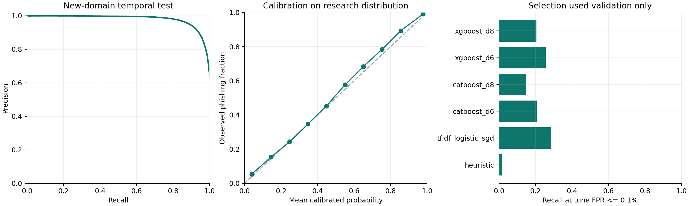

# Model Card — Guardian Lab URL Core v1

Tanggal evaluasi: 2026-11-01T05:23:09.343254+00:00. Model: **tfidf_logistic_sgd**.

**Status: kandidat riset terlatih. Recall masih terbatas; belum layak menjadi satu-satunya penentu keamanan atau dipromosikan otomatis ke aplikasi.**

## Tujuan dan cakupan

Mendukung pilar Recognize Guardian Lab dengan indikator phishing pada URL HTTP/HTTPS. URL hasil QR memakai representasi, model, kalibrator, dan threshold yang sama. Model tidak membuka situs dan tidak menganalisis malware APK, konten halaman, redirect, atau merchant QRIS.

## Data dan audit

PhreshPhish dipin pada revision `eca603e0ecd4f698f8d4d226c088659e72681239`. PhiUSIIL dipakai hanya sebagai pembanding eksternal dengan mapping 0 sumber menjadi phishing=1.

Sumber resmi: [PhreshPhish](https://huggingface.co/datasets/phreshphish/phreshphish) dan [PhiUSIIL UCI](https://archive.ics.uci.edu/dataset/967/phiusiil+phishing+url+dataset). Keduanya mencantumkan CC BY 4.0; card PhreshPhish juga menyebut riset anti-phishing. Ketentuan sumber tetap harus diperiksa sebelum penggunaan atau distribusi lain.

Audit membaca 902.110 baris sumber. Pemeriksaan ulang sanitasi sempat mendeteksi pola residual; aturan diperbaiki dan ingestion diulang sebelum training. Seluruh 16 pemeriksaan akhir lulus. Screening regex bukan bukti bahwa semua informasi pribadi atau seluruh kesalahan label sudah ditemukan.

- Query/fragment dibuang identik pada kedua kelas untuk mengurangi artefak privasi sumber.
- 33,660 baris sumber ditolak oleh kebijakan input/privacy sebelum kurasi. Pada phishing train, 20.941 dari 221.526 baris ditolak; cakupan model tidak boleh disamakan dengan seluruh URL sumber. Rincian per kelas/alasan ada pada audit JSON.
- 43 URL core memiliki label berbeda; 7.053 baris terkait dikeluarkan. Ini dapat berasal dari hilangnya konteks setelah transformasi atau perubahan status, bukan otomatis kesalahan label asli.
- 51.216 duplikat canonical dalam sumber dikeluarkan, dihitung pada seluruh sumber yang diproses.
- 1.379 baris train bertabrakan dengan URL core test dan 605 baris berada di hari batas test; keduanya dikeluarkan.
- 69.401 baris validasi memiliki domain yang sudah muncul pada fit dan dikeluarkan dari validasi.
- Label kampanye tidak tersedia; domain-disjoint tidak membuktikan campaign-disjoint.

| Partisi     |   Baris |  Benign | Phishing | Kelompok domain/tenant |
| ----------- | ------: | ------: | -------: | ---------------------: |
| calibration |  14,695 |   7,473 |    7,222 |                 12,178 |
| external    | 219,036 | 133,440 |   85,596 |                190,364 |
| fit         | 302,812 | 162,080 |  140,732 |                130,998 |
| test        | 154,953 |  85,786 |   69,167 |                 77,042 |
| threshold   |  14,430 |   7,537 |    6,893 |                 12,216 |
| tune        |  31,348 |  15,010 |   16,338 |                 24,477 |

Fit: 2 Juli 2024–22 Februari 2025. Validasi: 23 Februari–7 September 2025. Test: 8 September–16 Desember 2025. Tune, calibration, dan threshold dipisahkan menurut domain/tenant dalam periode validasi. Test domain baru tidak berbagi kelompok dengan seluruh pengembangan.

## Perbandingan kandidat pada tune

Pemenang dipilih dari recall pada FPR empiris maksimal 0,1%, lalu average precision. Pemilihan selesai sebelum test final. Ini eksperimen beranggaran terbatas, bukan pencarian optimum global.

Heuristik adalah baseline penelitian Python, bukan port identik scoring TypeScript aplikasi web.

| Kandidat           |  Recall |    FPR | Average precision | Fit + tune (detik) |
| ------------------ | ------: | -----: | ----------------: | -----------------: |
| heuristic          |  1.732% | 0.060% |            0.6088 |                0.0 |
| tfidf_logistic_sgd | 28.394% | 0.100% |            0.9405 |               42.8 |
| catboost_d6        | 20.645% | 0.100% |            0.9170 |               15.0 |
| catboost_d8        | 14.892% | 0.100% |            0.9191 |               16.2 |
| xgboost_d6         | 25.670% | 0.093% |            0.9123 |                5.7 |
| xgboost_d8         | 20.486% | 0.060% |            0.9162 |                5.3 |

Pemenang memakai TF-IDF karakter 3–5 gram, vocabulary maksimal 40.000 yang di-fit pada 100.000 contoh fit deterministik, dan logistic regression dengan optimizer SGD. Seluruh 302.812 contoh fit digunakan untuk pelatihan classifier. Dua alpha dicoba, masing-masing maksimal 12 epoch dengan penghentian berbasis tune. CatBoost/XGBoost membandingkan depth 6 dan 8, maksimal 800 iterasi, early stopping 60, pada 34 fitur numerik dan suffix. Tidak ada full-hostname kategori.

Kalibrasi sigmoid dipilih melalui group holdout pada partisi calibration. Probabilitas mengacu pada distribusi riset PhreshPhish, bukan prevalensi trafik pengguna Guardian Lab.

## Test utama pada domain baru

80.052 baris: 29.146 benign, 50.906 phishing, 59.880 domain/tenant. Kedua threshold berikut sudah dibekukan dari partisi threshold sebelum test. Baris peringatan mencakup MEDIUM dan HIGH.

| Kebijakan                | Threshold p | Precision benchmark |  Recall |    FPR | FP / benign |
| ------------------------ | ----------: | ------------------: | ------: | -----: | ----------: |
| Peringatan MEDIUM + HIGH | 0.916262764 |             99.208% | 69.864% | 0.974% | 284 / 29146 |
| Indikasi kuat HIGH       | 0.991263984 |             99.888% | 31.505% | 0.062% |  18 / 29146 |

Average precision: 0.9797; ROC-AUC: 0.9624; Brier: 0.0717. HIGH memiliki accuracy 56.421% pada komposisi test ini; precision tinggi tidak berarti accuracy atau recall tinggi.

Bootstrap 200 kali per domain: CI95 recall HIGH 30.612%–32.646%; FPR 0.031%–0.090%. Interval mencerminkan sampel/domain dalam sumber ini, tidak menjamin ketahanan terhadap perubahan modus atau noise label.

## Pembanding eksternal

PhiUSIIL domain baru: 194.559 baris setelah mengeluarkan URL/domain yang tumpang tindih dengan pengembangan dan test PhreshPhish. Dataset berbeda sumber ini tetap memiliki bias koleksi dan tidak menggantikan data Indonesia atau holdout 2026.

| Kebijakan | Precision benchmark |  Recall |    FPR |
| --------- | ------------------: | ------: | -----: |
| low       |             98.231% | 58.163% | 0.648% |
| high      |             99.945% | 24.373% | 0.008% |

## Artifact dan inferensi

Bundle lokal: `ml/artifacts/url-core-v1.joblib`, 811,300 byte. Binary dan dataset diabaikan Git. Manifest, kalibrator, threshold, dependency, PSL offline, schema, hash implementasi, dan checksum menyertai model.

SHA-256 bundle: `7e5f8849edec6e3612ea530e9b9148e98137b40111c2fa6e73d66281d4985c02`.

Inferensi CPU 4 thread, batch 1, 100 contoh: p50 4.24 ms; p95 6.58 ms; startup 0.294 detik. RAM pada final-test.json adalah proses evaluasi yang memuat dataset, bukan kebutuhan RAM inferensi saja.

Parity URL/QR, query diabaikan konsisten, save/reload, checksum rusak, dan schema tidak kompatibel sudah diuji dengan artifact nyata. Loader hanya menerima artifact training yang dipercaya; checksum bukan perlindungan untuk deserialize pickle dari pihak asing.

## Batas kemampuan dan keputusan

Model ini dapat memberi peringatan awal, tetapi masih melewatkan sebagian besar phishing pada threshold HIGH. Jangan menggunakan LOW sebagai jaminan aman. Ketentuan input/privacy juga menolak sebagian URL; evaluasi di atas hanya berlaku untuk sampel yang lolos kebijakan tersebut.

Gold set Indonesia, observasi terbaru 2026, verifikasi label manual, dan kampanye lintas domain masih perlu dikerjakan. Query-only threats dan domain sah yang disusupi dapat sulit dibedakan. Belum ada integrasi ke aplikasi web atau promosi produksi.

Precision sangat dipengaruhi prevalensi. Pada asumsi hipotetis prevalensi phishing 0,1% dan recall/FPR HIGH yang sama, precision yang dihitung hanya 33.803%. Ini simulasi matematis, bukan hasil trafik nyata.

Bukti: [data audit](./data-audit.json), [protokol](./run-protocol.json), [validasi](./validation-results.json), [pilihan beku](./frozen-selection.json), [test final](./final-test.json), [dua threshold](./operating-thresholds.json).
