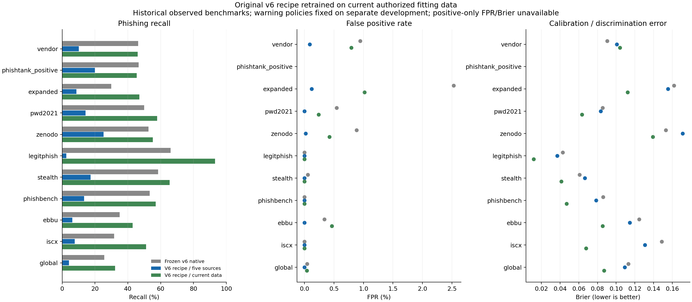

# Pelatihan recipe v6 dengan data saat ini

Selesai: 2026-11-07T03:20:08.400351+00:00. Dua model baru dilatih dari nol menggunakan constructor/hyperparameter asli v6. Keduanya menggunakan Logistic Regression C=2, TF-IDF karakter 100k/kata 20k, fitur numerik, bobot sumber akar kuadrat, serta sigmoid calibration tanpa bobot. Tidak ada pencarian hyperparameter atau pemilihan pemenang dari test.

## Perbandingan yang diuji

| Model | URL fitting | Sumber | Keterangan |
| --- | ---: | ---: | --- |
| Frozen v6 asli | 532.793 | 5 | Binary, calibration dan threshold layanan tetap asli |
| Recipe v6 / lima sumber terkurasi | 524,699 | 5 | Encoder/classifier/calibrator baru; semua constructor cocok dengan v6 |
| Recipe v6 / seluruh fitting terbaru | 671,440 | 11 | Encoder/classifier/calibrator baru; semua constructor cocok dengan v6 |

Jumlah sumber kelima dicocokkan langsung dengan metadata asli: `mendeley2020`. [Audit schema sebelum fitting](v6-current-retrain-source-schema-audit.json) mencatat koreksi alias deskriptif `mendeley`; belum ada model atau prediksi test saat koreksi dilakukan.

Perbedaan **seluruh fitting terbaru vs lima sumber terkurasi** mengukur pengaruh tambahan data dengan recipe, sanitasi, calibration, threshold dan tune yang sama. Perbandingan langsung terhadap binary frozen v6 juga mencakup perubahan kurasi privasi serta komposisi development, sehingga tidak boleh seluruhnya diatribusikan pada jumlah data. Sanitizer eksperimen melakukan redaksi assignment secret pendek; preprocessing v6 asli tidak diam-diam diubah.

## Development sebelum replay

Calibration 50.749, threshold 58.840 dan tune 107.094 dipisahkan berdasarkan domain/private tenant. Vocabulary/IDF/scaler hanya di-fit pada fitting. Threshold warning/HIGH mengikuti recipe asli: batas FPR empiris per sumber 1%/0,1%. Batas ini tidak menjamin FPR pada test atau trafik nyata.

| Model | Macro recall tune | FPR tune | Macro Brier tune | Warning | HIGH |
| --- | ---: | ---: | ---: | ---: | ---: |
| v6 asli / threshold asli | 45.499% | 0.539% | 0.111730 | 0.904713286 | 0.988474493 |
| v6 asli / threshold development sama | 14.456% | 0.028% | 0.111730 | 0.990422369 | 0.991990469 |
| Recipe v6 / lima sumber terkurasi | 16.608% | 0.043% | 0.111819 | 0.991498998 | 0.995478832 |
| Recipe v6 / seluruh fitting terbaru | 47.441% | 0.372% | 0.093545 | 0.940426267 | 0.990663188 |

Gate peningkatan current vs foundation: **False**. Delta macro recall +30.833 pp, delta recall sumber terburuk +16.826 pp, delta macro Brier -0.018274. Gate ditetapkan sebelum fitting. Semua model dan threshold dibekukan sebelum replay; tidak ada promosi otomatis.

## Replay pada benchmark yang telah teramati

Seluruh cohort berikut sudah pernah teramati dalam eksperimen terdahulu. Pembekuan baru melindungi pemisahan prosedur training/test dalam percobaan ini; tidak mengubah benchmark lama menjadi test independen baru atau gold Indonesia.

| Cohort | Model | Benign / phishing | TP / FN / FP / TN | Accuracy | Recall | Precision sampel | FPR | Brier | ECE |
| --- | --- | ---: | --- | ---: | ---: | ---: | ---: | ---: | ---: |
| observed_vendor | v6 asli / threshold asli | 17789 / 2211 | 1024 / 1187 / 168 / 17621 | 93.225% | 46.314% | 85.906% | 0.944% | 0.090239 | 0.154501 |
| observed_vendor | v6 asli / threshold development sama | 17789 / 2211 | 187 / 2024 / 11 / 17778 | 89.825% | 8.458% | 94.444% | 0.062% | 0.090239 | 0.154501 |
| observed_vendor | Recipe v6 / lima sumber terkurasi | 17789 / 2211 | 224 / 1987 / 16 / 17773 | 89.985% | 10.131% | 93.333% | 0.090% | 0.100582 | 0.172009 |
| observed_vendor | Recipe v6 / seluruh fitting terbaru | 17789 / 2211 | 1017 / 1194 / 141 / 17648 | 93.325% | 45.997% | 87.824% | 0.793% | 0.103913 | 0.178063 |
| observed_phishtank_positive | v6 asli / threshold asli | 0 / 9269 | 4313 / 4956 / 0 / 0 | n/a | 46.531% | n/a | n/a | n/a | n/a |
| observed_phishtank_positive | v6 asli / threshold development sama | 0 / 9269 | 1638 / 7631 / 0 / 0 | n/a | 17.672% | n/a | n/a | n/a | n/a |
| observed_phishtank_positive | Recipe v6 / lima sumber terkurasi | 0 / 9269 | 1855 / 7414 / 0 / 0 | n/a | 20.013% | n/a | n/a | n/a | n/a |
| observed_phishtank_positive | Recipe v6 / seluruh fitting terbaru | 0 / 9269 | 4209 / 5060 / 0 / 0 | n/a | 45.409% | n/a | n/a | n/a | n/a |
| observed_expanded | v6 asli / threshold asli | 3243 / 8393 | 2506 / 5887 / 82 / 3161 | 48.702% | 29.858% | 96.832% | 2.529% | 0.161907 | 0.113510 |
| observed_expanded | v6 asli / threshold development sama | 3243 / 8393 | 611 / 7782 / 1 / 3242 | 33.113% | 7.280% | 99.837% | 0.031% | 0.161907 | 0.113510 |
| observed_expanded | Recipe v6 / lima sumber terkurasi | 3243 / 8393 | 722 / 7671 / 4 / 3239 | 34.041% | 8.602% | 99.449% | 0.123% | 0.155349 | 0.086191 |
| observed_expanded | Recipe v6 / seluruh fitting terbaru | 3243 / 8393 | 3952 / 4441 / 33 / 3210 | 61.550% | 47.087% | 99.172% | 1.018% | 0.112279 | 0.031831 |
| observed_pwd2021 | v6 asli / threshold asli | 1654 / 1890 | 943 / 947 / 9 / 1645 | 73.025% | 49.894% | 99.055% | 0.544% | 0.085531 | 0.039496 |
| observed_pwd2021 | v6 asli / threshold development sama | 1654 / 1890 | 213 / 1677 / 0 / 1654 | 52.681% | 11.270% | 100.000% | 0.000% | 0.085531 | 0.039496 |
| observed_pwd2021 | Recipe v6 / lima sumber terkurasi | 1654 / 1890 | 270 / 1620 / 0 / 1654 | 54.289% | 14.286% | 100.000% | 0.000% | 0.083543 | 0.032366 |
| observed_pwd2021 | Recipe v6 / seluruh fitting terbaru | 1654 / 1890 | 1093 / 797 / 4 / 1650 | 77.398% | 57.831% | 99.635% | 0.242% | 0.063471 | 0.032528 |
| observed_zenodo | v6 asli / threshold asli | 9643 / 2944 | 1548 / 1396 / 85 / 9558 | 88.234% | 52.582% | 94.795% | 0.881% | 0.153102 | 0.224269 |
| observed_zenodo | v6 asli / threshold development sama | 9643 / 2944 | 670 / 2274 / 1 / 9642 | 81.926% | 22.758% | 99.851% | 0.010% | 0.153102 | 0.224269 |
| observed_zenodo | Recipe v6 / lima sumber terkurasi | 9643 / 2944 | 744 / 2200 / 2 / 9641 | 82.506% | 25.272% | 99.732% | 0.021% | 0.171199 | 0.252500 |
| observed_zenodo | Recipe v6 / seluruh fitting terbaru | 9643 / 2944 | 1627 / 1317 / 41 / 9602 | 89.211% | 55.265% | 97.542% | 0.425% | 0.139146 | 0.223030 |
| observed_legitphish | v6 asli / threshold asli | 28 / 42688 | 28179 / 14509 / 0 / 28 | 66.034% | 66.012% | 100.000% | 0.000% | 0.042691 | 0.120744 |
| observed_legitphish | v6 asli / threshold development sama | 28 / 42688 | 349 / 42339 / 0 / 28 | 0.883% | 0.818% | 100.000% | 0.000% | 0.042691 | 0.120744 |
| observed_legitphish | Recipe v6 / lima sumber terkurasi | 28 / 42688 | 1086 / 41602 / 0 / 28 | 2.608% | 2.544% | 100.000% | 0.000% | 0.036780 | 0.101417 |
| observed_legitphish | Recipe v6 / seluruh fitting terbaru | 28 / 42688 | 39778 / 2910 / 0 / 28 | 93.188% | 93.183% | 100.000% | 0.000% | 0.011586 | 0.032207 |
| observed_stealth | v6 asli / threshold asli | 26578 / 8317 | 4865 / 3452 / 15 / 26563 | 90.064% | 58.495% | 99.693% | 0.056% | 0.060737 | 0.120918 |
| observed_stealth | v6 asli / threshold development sama | 26578 / 8317 | 1217 / 7100 / 0 / 26578 | 79.653% | 14.633% | 100.000% | 0.000% | 0.060737 | 0.120918 |
| observed_stealth | Recipe v6 / lima sumber terkurasi | 26578 / 8317 | 1437 / 6880 / 0 / 26578 | 80.284% | 17.278% | 100.000% | 0.000% | 0.066352 | 0.133798 |
| observed_stealth | Recipe v6 / seluruh fitting terbaru | 26578 / 8317 | 5452 / 2865 / 0 / 26578 | 91.790% | 65.552% | 100.000% | 0.000% | 0.041282 | 0.102216 |
| observed_phishbench | v6 asli / threshold asli | 2 / 270 | 144 / 126 / 0 / 2 | 53.676% | 53.333% | 100.000% | 0.000% | 0.086105 | 0.180766 |
| observed_phishbench | v6 asli / threshold development sama | 2 / 270 | 35 / 235 / 0 / 2 | 13.603% | 12.963% | 100.000% | 0.000% | 0.086105 | 0.180766 |
| observed_phishbench | Recipe v6 / lima sumber terkurasi | 2 / 270 | 36 / 234 / 0 / 2 | 13.971% | 13.333% | 100.000% | 0.000% | 0.078493 | 0.164301 |
| observed_phishbench | Recipe v6 / seluruh fitting terbaru | 2 / 270 | 154 / 116 / 0 / 2 | 57.353% | 57.037% | 100.000% | 0.000% | 0.046809 | 0.122350 |
| observed_ebbu | v6 asli / threshold asli | 2367 / 6482 | 2266 / 4216 / 8 / 2359 | 52.266% | 34.958% | 99.648% | 0.338% | 0.124672 | 0.167408 |
| observed_ebbu | v6 asli / threshold development sama | 2367 / 6482 | 290 / 6192 / 0 / 2367 | 30.026% | 4.474% | 100.000% | 0.000% | 0.124672 | 0.167408 |
| observed_ebbu | Recipe v6 / lima sumber terkurasi | 2367 / 6482 | 397 / 6085 / 0 / 2367 | 31.235% | 6.125% | 100.000% | 0.000% | 0.114470 | 0.145335 |
| observed_ebbu | Recipe v6 / seluruh fitting terbaru | 2367 / 6482 | 2785 / 3697 / 11 / 2356 | 58.097% | 42.965% | 99.607% | 0.465% | 0.085564 | 0.102561 |
| observed_iscx | v6 asli / threshold asli | 70 / 1996 | 632 / 1364 / 0 / 70 | 33.979% | 31.663% | 100.000% | 0.000% | 0.148829 | 0.275334 |
| observed_iscx | v6 asli / threshold development sama | 70 / 1996 | 119 / 1877 / 0 / 70 | 9.148% | 5.962% | 100.000% | 0.000% | 0.148829 | 0.275334 |
| observed_iscx | Recipe v6 / lima sumber terkurasi | 70 / 1996 | 152 / 1844 / 0 / 70 | 10.745% | 7.615% | 100.000% | 0.000% | 0.130734 | 0.247477 |
| observed_iscx | Recipe v6 / seluruh fitting terbaru | 70 / 1996 | 1022 / 974 / 0 / 70 | 52.856% | 51.202% | 100.000% | 0.000% | 0.067721 | 0.146543 |
| observed_global | v6 asli / threshold asli | 30627 / 19373 | 4977 / 14396 / 14 / 30613 | 71.180% | 25.690% | 99.719% | 0.046% | 0.112897 | 0.059382 |
| observed_global | v6 asli / threshold development sama | 30627 / 19373 | 608 / 18765 / 0 / 30627 | 62.470% | 3.138% | 100.000% | 0.000% | 0.112897 | 0.059382 |
| observed_global | Recipe v6 / lima sumber terkurasi | 30627 / 19373 | 803 / 18570 / 0 / 30627 | 62.860% | 4.145% | 100.000% | 0.000% | 0.109098 | 0.040295 |
| observed_global | Recipe v6 / seluruh fitting terbaru | 30627 / 19373 | 6254 / 13119 / 13 / 30614 | 73.736% | 32.282% | 99.793% | 0.042% | 0.086940 | 0.043028 |

Precision mengikuti prevalensi sampel; bukan estimasi precision trafik. Feed positif saja tidak memiliki accuracy biner, FPR, precision atau Brier.

| Cohort | Current − foundation recall 95% (pp) | Current − foundation FPR 95% (pp) | Current − v6 asli recall 95% (pp) |
| --- | --- | --- | --- |
| observed_vendor | [+33.963, +37.878] | [+0.583, +0.827] | [-1.643, +1.080] |
| observed_phishtank_positive | [+24.464, +26.321] | n/a | [-1.738, -0.487] |
| observed_expanded | [+37.248, +39.559] | [+0.590, +1.240] | [+16.246, +18.166] |
| observed_pwd2021 | [+40.807, +46.158] | [+0.056, +0.486] | [+6.147, +9.717] |
| observed_zenodo | [+28.328, +31.708] | [+0.271, +0.530] | [+1.572, +3.795] |
| observed_legitphish | [+90.249, +91.051] | [+0.000, +0.000] | [+26.672, +27.670] |
| observed_stealth | [+47.095, +49.482] | [+0.000, +0.000] | [+6.168, +7.891] |
| observed_phishbench | [+37.244, +50.000] | [+0.000, +0.000] | [+0.895, +6.859] |
| observed_ebbu | [+35.334, +38.349] | [+0.210, +0.759] | [+6.926, +8.974] |
| observed_iscx | [+40.987, +46.182] | [+0.000, +0.000] | [+17.527, +21.735] |
| observed_global | [+27.384, +28.846] | [+0.020, +0.066] | [+6.080, +7.068] |

Interval memakai 1.000 bootstrap domain/private tenant berpasangan. Wilson, reliability bins, metrik HIGH, perbandingan threshold-matched dan subgroup panjang/path dalam/private/non-private tersedia di JSON. Nol FP pada sedikit benign tetap memiliki ketidakpastian; PhishBench hanya dua benign dan ISCX hanya 70 benign.

## Data dan batas kesimpulan

| Sumber fitting terbaru | Jumlah |
| --- | ---: |
| phresh | 295,571 |
| phiusiil | 115,326 |
| deepurlbench | 99,953 |
| phishbd | 58,806 |
| stealthphisher | 52,334 |
| pwd2021 | 20,116 |
| phishvn_core | 9,769 |
| wangchuk | 8,546 |
| mendeley2020 | 4,080 |
| compphish | 3,883 |
| iscx2016_replica | 3,056 |

- Hanya partisi fitting yang diizinkan digabungkan: base 616.050, Stealth 52.334, ISCX 3.056. Semua 169.393 Mendeley reserved dan semua holdout historis tetap terpisah.
- Kedua encoder memakai batas vocabulary 150.000, source cap 60.000 dan seed asli 20261101. Source ID tidak menjadi fitur classifier.
- Label penerbit bisa salah dan pemisahan domain tidak menjamin independensi kampanye. Tidak dibuat reviewer, label manusia atau validasi Indonesia baru.
- Sanitasi tetap heuristik. Tidak ada target URL yang dikunjungi, HTML dijalankan, atau baris dataset dikirim ke LLM.
- Foundation DeepURLBench membatasi penggunaan nonkomersial. Hak data Ebbu dan data asli replika ISCX belum memiliki clearance redistribusi/komersial. Artifact tambahan disimpan lokal untuk riset.
- Model layanan/notebook tetap v6 asli dan production_ready=false. LOW tidak berarti aman.

## Verifikasi dan lokasi hasil

**237 tes lulus**, nol gagal/error/skip. Constructor seluruh estimator dibandingkan dengan artifact v6 asli; seluruh confusion matrix warning/HIGH dihitung ulang dari skor tersimpan. Prediksi diperiksa ulang setelah reload pada probe tersebar di setiap cohort; delta <=1e-12. Binary, metadata dan threshold layanan asli, registry dan seluruh delapan sidecar tetap utuh.

[Protokol](v6-current-retrain-20261107-protocol.json), [JSON lengkap](v6-current-retrain-evaluation.json), [verifikasi](v6-current-retrain-verification.json). Data gabungan, model, checkpoint dan skor tersimpan di `ml/runs/v6-current-retrain-20261107/`, yang diabaikan Git.

Pemeriksaan lokal: `python scripts/experiment_v6_current_retrain.py check` dan `python scripts/report_v6_current_retrain.py`. Runner memiliki tahap prepare/train/evaluate, menolak overwrite freeze/evaluasi dan memeriksa hash sebelum melanjutkan checkpoint. Pengulangan training membutuhkan run baru dengan input/protokol terpin; jangan menghapus registry exposure.
