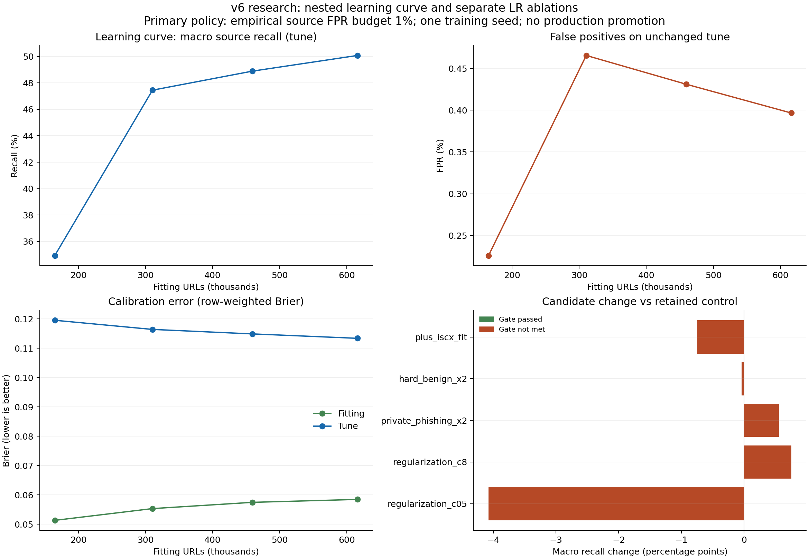

# Learning curve, regularisasi, pembobotan dan data tambahan v6

Selesai: 2026-11-07T02:42:32.421084+00:00. Model riset yang dipertahankan: **control**. Gate development belum terpenuhi oleh kandidat baru. Challenger yang dibekukan untuk evaluasi: `regularization_c8`. Model layanan dan notebook utama tetap v6 asli; `production_ready=false`.

Delapan classifier Logistic Regression baru dilatih: tiga titik learning curve dan lima ablation. Model control yang sudah dibekukan menjadi titik 100%. Semua kalibrator baru memakai calibration terpisah. Seleksi hanya menggunakan tune; learning curve tidak ikut menjadi calon pemenang.

## Learning curve

Persentase adalah proporsi domain/private tenant, bukan jumlah baris persis. Subset saling bersarang; vocabulary, IDF dan scaler dilatih ulang pada setiap subset. Satu seed tidak mengukur variasi antartraining.

| Fraksi domain | URL fitting | Domain/tenant | Fitur | Macro recall tune | FPR tune | Macro Brier tune |
| --- | ---: | ---: | ---: | ---: | ---: | ---: |
| 25% | 164,835 | 106,030 | 169,029 | 34.928% | 0.226% | 0.103498 |
| 50% | 310,415 | 212,061 | 172,245 | 47.455% | 0.465% | 0.097642 |
| 75% | 459,425 | 318,092 | 171,333 | 48.898% | 0.431% | 0.094089 |
| 100% | 616,050 | 424,123 | 170,346 | 50.086% | 0.397% | 0.091928 |

Perubahan macro recall dari 75% ke 100%: **+1.188 percentage point**. Ini diagnosis terhadap komposisi data dan recipe saat ini, bukan bukti bahwa penambahan data apa pun akan memperbaiki model.

## Kandidat development

Threshold utama ditentukan pada threshold partition dengan batas FPR empiris 1% per sumber yang memiliki >=100 benign. Batas itu tidak menjamin FPR tune, test, kelompok kecil, atau trafik nyata. Private/non-private hosting diperiksa tersendiri.

| Kandidat | URL fitting | Macro recall | Recall private hosting | FPR tune | Macro Brier | Gate |
| --- | ---: | ---: | ---: | ---: | ---: | --- |
| control | 616,050 | 50.086% | 88.063% | 0.397% | 0.091928 | control |
| regularization_c05 | 616,050 | 46.010% | 86.270% | 0.408% | 0.093347 | False |
| regularization_c8 | 616,050 | 50.841% | 87.831% | 0.403% | 0.093991 | False |
| private_phishing_x2 | 616,050 | 50.645% | 90.677% | 0.426% | 0.092226 | False |
| hard_benign_x2 | 616,050 | 50.047% | 88.085% | 0.411% | 0.092717 | False |
| plus_iscx_fit | 619,106 | 49.341% | 86.867% | 0.402% | 0.091695 | False |

| Kandidat | Delta macro recall (pp) | Delta recall sumber terburuk (pp) | Delta Brier | Guard private/non-private |
| --- | ---: | ---: | ---: | --- |
| regularization_c05 | -4.076 | -6.067 | +0.001419 | False |
| regularization_c8 | +0.755 | -0.268 | +0.002063 | True |
| private_phishing_x2 | +0.559 | -0.268 | +0.000298 | False |
| hard_benign_x2 | -0.039 | -0.873 | +0.000789 | True |
| plus_iscx_fit | -0.745 | -3.499 | -0.000233 | False |

## Pengujian setelah model dan threshold dibekukan

Ebbu tidak digunakan sebagai sumber tambahan fitting dalam eksperimen ini. PWD2021 sebelumnya memakai sebagian data asal Ebbu: pemisahan domain/URL menutup overlap identitas, tetapi tidak membuktikan independensi penuh dari proses pengumpulan. ISCX adalah holdout domain dari sumber yang juga memasok 3.056 baris fitting. Global 50.000 adalah benchmark yang sudah teramati.

| Cohort | Model | N benign / phishing | TP / FN / FP / TN | Recall | Precision sampel | FPR | Brier | ECE |
| --- | --- | ---: | --- | ---: | ---: | ---: | ---: | ---: |
| ebbu_external | active_v6 | 2367 / 6482 | 2266 / 4216 / 8 / 2359 | 34.958% | 99.648% | 0.338% | 0.124672 | 0.167408 |
| ebbu_external | control | 2367 / 6482 | 2667 / 3815 / 11 / 2356 | 41.145% | 99.589% | 0.465% | 0.091345 | 0.113270 |
| ebbu_external | regularization_c8 | 2367 / 6482 | 2719 / 3763 / 12 / 2355 | 41.947% | 99.561% | 0.507% | 0.096791 | 0.122641 |
| iscx_external | active_v6 | 70 / 1996 | 632 / 1364 / 0 / 70 | 31.663% | 100.000% | 0.000% | 0.148829 | 0.275334 |
| iscx_external | control | 70 / 1996 | 768 / 1228 / 0 / 70 | 38.477% | 100.000% | 0.000% | 0.101876 | 0.195946 |
| iscx_external | regularization_c8 | 70 / 1996 | 769 / 1227 / 0 / 70 | 38.527% | 100.000% | 0.000% | 0.113902 | 0.212932 |
| observed_global_50000 | active_v6 | 30627 / 19373 | 4977 / 14396 / 14 / 30613 | 25.690% | 99.719% | 0.046% | 0.112897 | 0.059382 |
| observed_global_50000 | control | 30627 / 19373 | 5812 / 13561 / 16 / 30611 | 30.001% | 99.725% | 0.052% | 0.096128 | 0.032857 |
| observed_global_50000 | regularization_c8 | 30627 / 19373 | 5969 / 13404 / 21 / 30606 | 30.811% | 99.649% | 0.069% | 0.104596 | 0.034532 |

Precision di tabel mengikuti prevalensi sampel; bukan estimasi precision trafik. Domain bootstrap berpasangan memakai 1.000 replikasi. Wilson mengasumsikan baris independen dan ditampilkan bersama bootstrap dalam JSON.

| Cohort | Delta recall challenger−control, 95% (pp) | Delta FPR, 95% (pp) | FPR challenger Wilson 95% |
| --- | --- | --- | --- |
| ebbu_external | [0.200, 1.457] | [-0.130, 0.219] | [0.290, 0.884] |
| iscx_external | [-1.050, 1.171] | [0.000, 0.000] | [0.000, 5.202] |
| observed_global_50000 | [0.507, 1.107] | [-0.003, 0.039] | [0.045, 0.105] |

## Kebijakan threshold yang telah ditetapkan sebelum test

Semua kebijakan dilaporkan; hasil test tidak digunakan memilih kebijakan baru. Angka budget berikut adalah batas empiris development per sumber.

| Cohort | Model | Budget development | Threshold | Recall test | FPR test |
| --- | --- | ---: | ---: | ---: | ---: |
| ebbu_external | control | 0.500% | 0.993526045 | 13.144% | 0.000% |
| ebbu_external | control | 1.000% | 0.952643724 | 41.145% | 0.465% |
| ebbu_external | control | 2.000% | 0.910811516 | 52.391% | 1.098% |
| ebbu_external | regularization_c8 | 0.500% | 0.976186586 | 27.353% | 0.084% |
| ebbu_external | regularization_c8 | 1.000% | 0.942615388 | 41.947% | 0.507% |
| ebbu_external | regularization_c8 | 2.000% | 0.894501736 | 53.502% | 1.014% |
| iscx_external | control | 0.500% | 0.993526045 | 12.525% | 0.000% |
| iscx_external | control | 1.000% | 0.952643724 | 38.477% | 0.000% |
| iscx_external | control | 2.000% | 0.910811516 | 49.900% | 0.000% |
| iscx_external | regularization_c8 | 0.500% | 0.976186586 | 24.699% | 0.000% |
| iscx_external | regularization_c8 | 1.000% | 0.942615388 | 38.527% | 0.000% |
| iscx_external | regularization_c8 | 2.000% | 0.894501736 | 51.002% | 1.429% |
| observed_global_50000 | control | 0.500% | 0.993526045 | 9.126% | 0.003% |
| observed_global_50000 | control | 1.000% | 0.952643724 | 30.001% | 0.052% |
| observed_global_50000 | control | 2.000% | 0.910811516 | 38.729% | 0.137% |
| observed_global_50000 | regularization_c8 | 0.500% | 0.976186586 | 19.708% | 0.013% |
| observed_global_50000 | regularization_c8 | 1.000% | 0.942615388 | 30.811% | 0.069% |
| observed_global_50000 | regularization_c8 | 2.000% | 0.894501736 | 39.364% | 0.251% |

## Cakupan dan keterbatasan

- Intake 118.918 URL menghasilkan 118.038 representasi tersanitasi. Setelah novelty audit: fitting 3.056, Ebbu test 8.849, ISCX test 2.066. Semua input supported dicatat dalam sidecar exposure, termasuk yang dikeluarkan.
- Fitting tambahan hanya mencakup 108 benign dan 40 hard benign unik. Phishing private hosting bertambah 104. Tidak ada asumsi bahwa banyak data otomatis memperbaiki model.
- ISCX test hanya mempunyai 70 benign; angka FPR dan subgroup kecil perlu dibaca bersama intervalnya. Kesamaan byte replika ISCX dengan sumber asli belum dapat dibuktikan.
- Sumber historis dan label penerbit dapat salah. Tidak ada reviewer, label gold Indonesia, atau holdout temporal Indonesia baru yang dibuat.
- Sanitizer tetap heuristik. Tidak ada URL target dikunjungi, HTML dieksekusi, atau data mentah dikirim ke LLM.
- Lisensi eksplisit Ebbu dan hak data asli ISCX belum jelas; artifact tambahan tetap lokal riset. Foundation juga memiliki batas nonkomersial. Ini tidak memberi izin penggunaan komersial atau redistribusi data.
- Seluruh 169.393 kasus Mendeley yang sudah dicadangkan tetap tidak digunakan untuk fitting, calibration, threshold atau pemilihan model.

Penyaringan input per kelas (0=benign, 1=phishing):

| Sumber | Raw 0 / 1 | Supported 0 / 1 | Unsupported 0 / 1 |
| --- | ---: | ---: | ---: |
| ebbu2017 | 36400 / 37175 | 36341 / 36786 | 59 / 389 |
| iscx2016_replica | 35378 / 9965 | 35279 / 9632 | 99 / 333 |

## Verifikasi dan reproduksi

221 tes lulus; nol gagal/error/skip. 9 artifact diperiksa ulang pada masing-masing 128 probe; delta nol. Audit mencakup 26 sumber exposure/cache/identitas. Hash binary, metadata dan threshold v6 aktif tetap sama.

Protokol: [JSON](v6-learning-20261106-protocol.json). Hasil lengkap, interval, calibration bins dan subgroup: [JSON evaluasi](v6-learning-evaluation.json). [Verifikasi](v6-learning-verification.json). [Audit sumber](../../ai-agent-docs/research/v6-learning-source-audit-20261106.md). Artifact dan predictions berada di `ml/runs/v6-learning-20261106/` yang diabaikan Git.

Untuk memeriksa hasil lokal: `python scripts/experiment_v6_learning.py check`, `python scripts/verify_v6_learning.py`, `python scripts/render_v6_learning.py`. Runner menolak menimpa intake/seleksi/evaluasi yang telah dibekukan. Replay training memerlukan run/protokol baru dan hash input yang sama; menghapus registry exposure bukan prosedur replay yang sah.
